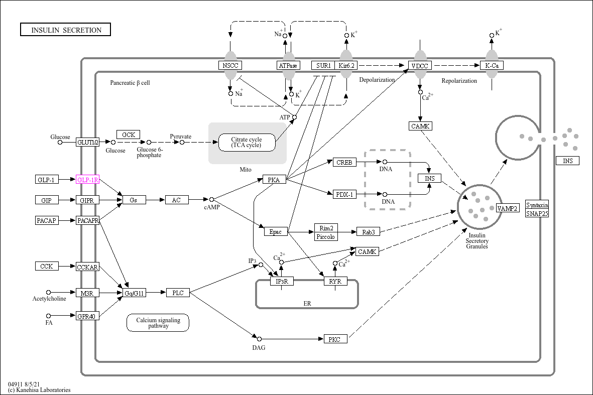
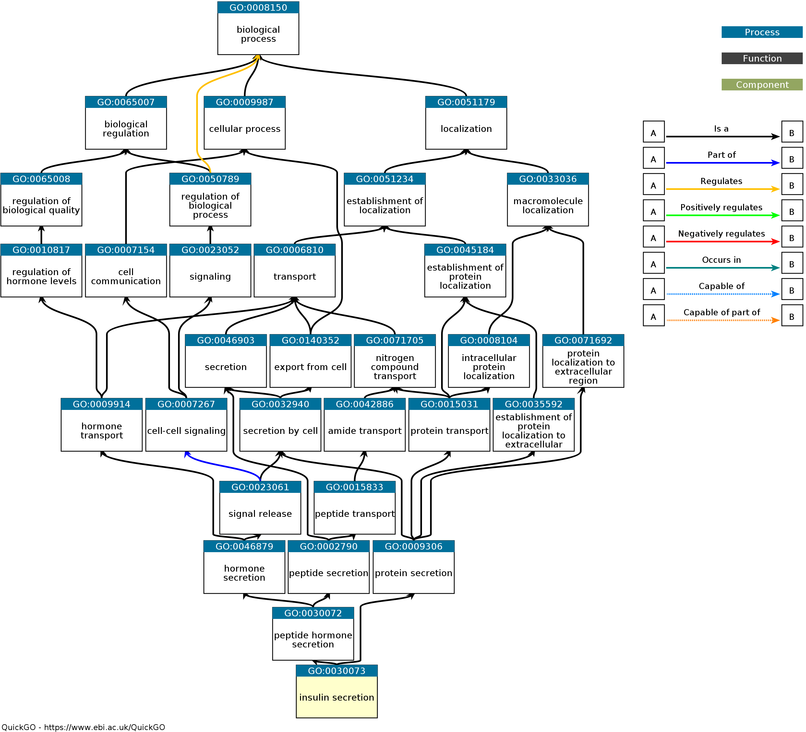
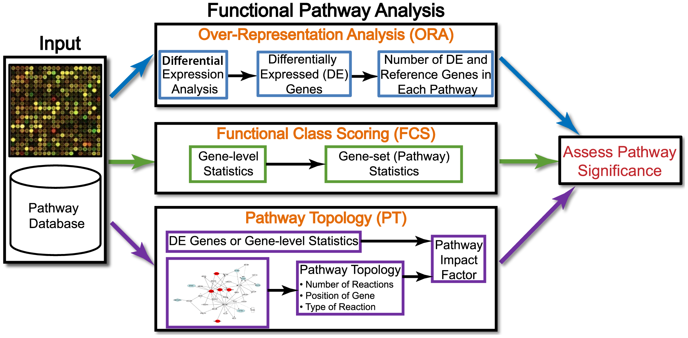
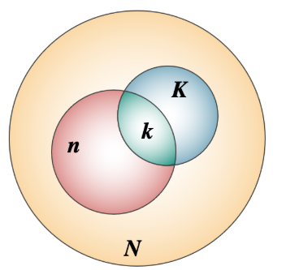
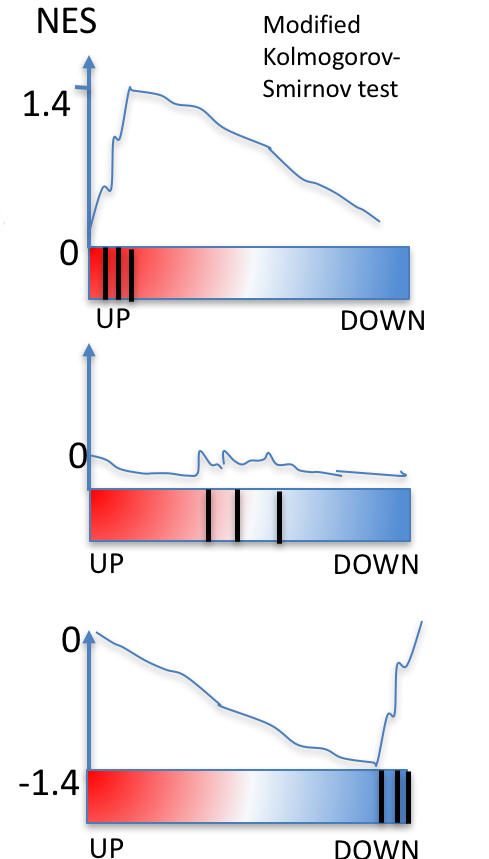
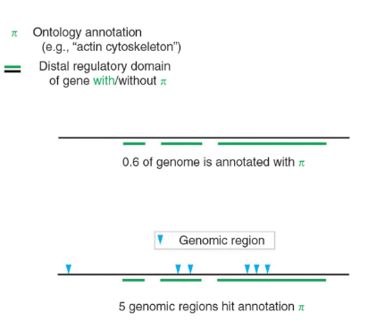
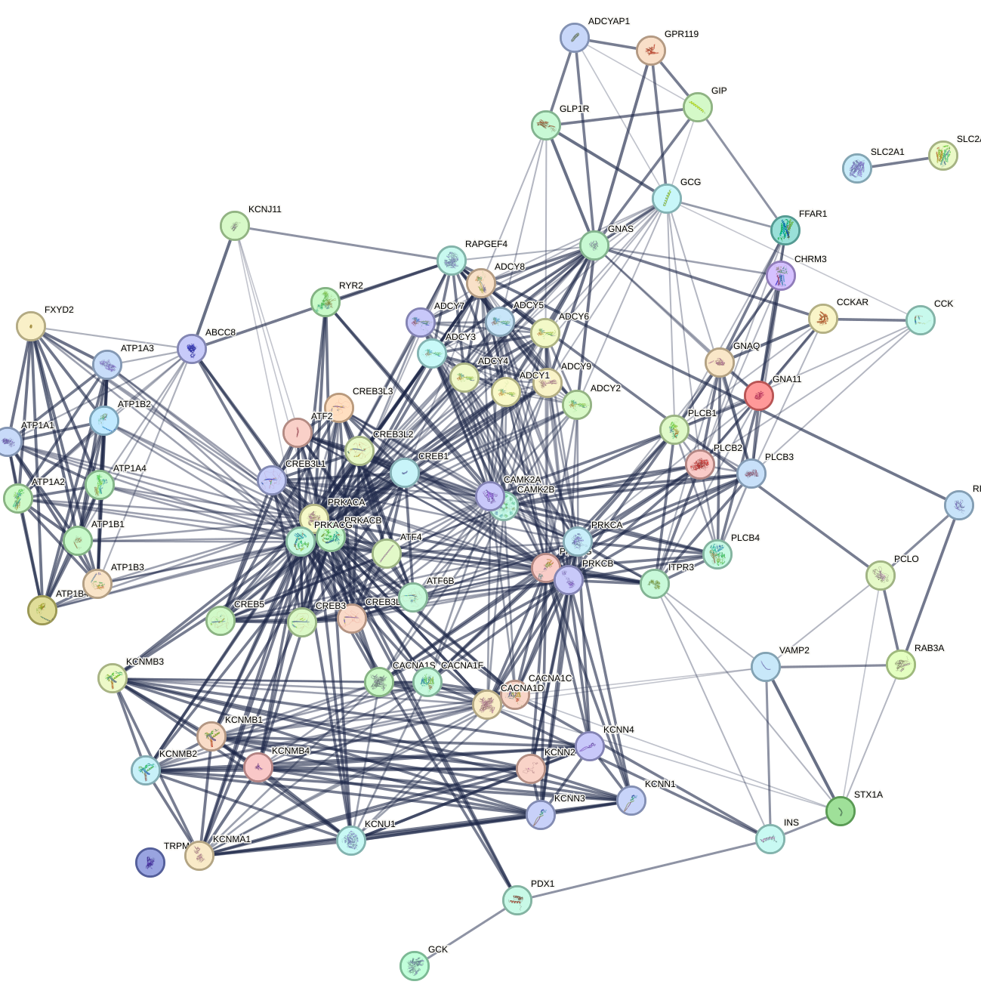
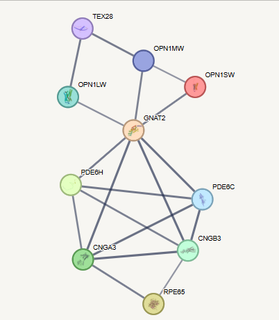
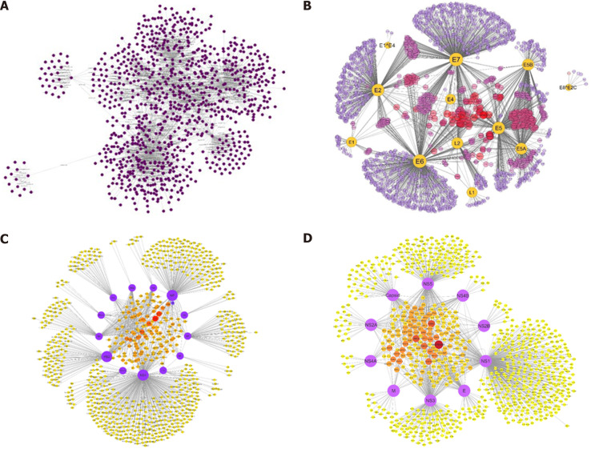

# Functional View in Genomics

## Connecting Differences to Pathways 

**Motivation**

* What are the implications of DNA-microarray/ChIP-seq results in the clinical perspective?

* If 300 genes are differentially expressed, what kind of biological pathways are affected?

{.absolute
.fragment .fade-in width="200" height="100" top="300" left="200"}
{.absolute .fragment
.fade-in width="200" height="200" top="450" left="200"} {.absolute
.fragment .fade-in width="300" height="100" top="350" left="400"} {.absolute
.fragment .fade-in width="300" height="250" top="400" left="400"}

::: {.fragment .fade-in .absolute width=300 height=100 top=400 left=750}

* I cannot lose weight because my genes involved in **fat synthesis** are upregulated compared to others.
:::

## Need for an Encyclopedia

* We have databases to annotate each gene with its:

  * Location in the genome

  * Molecular function

  * Biological pathways it involves

  * Co-regulated/expressed genes

  * Properties

## Databases Recording All Information

::: {.columns}

::: {.column width="50%"}
  **Kyoto Encyclopedia of Genes and Genomes (KEGG)**

  * Integrates genomic, biological pathway, disease, and drug information

  * Pathway maps depict molecular interaction networks including metabolic, signaling, and genetic information pathways.
:::

::: {.column width="50%"}
**Gene Ontology (GO)**

* GO is a standardized, hierarchical ontology for annotating gene products across species

* Annotates from three perspectives:

  * Biological process

  * Cellular component

  * Molecular functions
:::

:::

## Example of KEGG Pathways {.smaller}

:::: {.columns}

::: {.column width="50%"}
```{=html}
<iframe src="https://www.kegg.jp/entry/K04526/" width="500" height="500"></iframe>
```
:::

::: {.column width="50%"}

:::

Example of insulin annotation and insulin secretion process in KEGG
::::

## Example of GO Pathways {.smaller}


{width="60%"}

Example of insulin annotation and insulin secretion process in GO


# Enrichment Analysis

## Connecting Genes to Biological Functions

**Enrichment Analysis**
Summarizes identified differences in genes associated with common functions.

{height=350}


## Evolution of Functional Analysis 

Each generation of enrichment methods was developed to solve a specific limitation of the previous one:

| Era | Method | Driving Data | Problem Solved | 
| -- | --- | -- | ----- | 
| **\~2000** | **ORA** (Fisher's Exact Test) | Microarrays & GO | Summarizing a list of differentially expressed genes (DEGs) into pathways | 
| **2003–2005** | **GSEA** | Microarrays / RNA-seq | Removing arbitrary DEG cutoffs and capturing regulation direction | 
| **2010–2014** | **GREAT & ChIP-Enrich** | ChIP-seq | Handling distal regulatory regions and severe gene locus-length bias | 
| **Ongoing** | **Biological Networks (PPI)** | Multi-omics / STRING | Moving beyond independent "bags of genes" to physical interaction topologies | 

# Over-Representation Analysis (ORA)

## Over-Representation Analysis 

* **Motivation**: Are biological pathways enriched (over-represented) in an experimentally-derived gene list, e.g., a list of differentially expressed genes (DEGs)?

::: {.columns}

::: {.column width="50%"}



:::

::: {.column width="50%"}

* $N$: Background gene set

* $n$: Differentially expressed genes (DEGs)

* $M$: Genes in the pathway $\pi$

* $a$: Overlapping set (DEGs in pathway $\pi$)
:::

:::

## Problem Formulation 

**Problem Statement**

:::: {.columns}

::: {.column width="60%"}

* $100$ ($N$) genes detected in a microarray study

  * $10$ ($M$, G1–G10) of them belong to pathway $\pi$

  * $40$ ($n$, G1–G8, G11–G42) genes were differentially expressed

|  | DE | NOT DE | Row sum | 
| ----- | ----- | ----- | ----- | 
| In $\pi$ | 8 ($a$) | 2 ($b$) | 10 ($M$) | 
| NOT in $\pi$ | 32 ($c$) | 58 ($d$) | 90 ($N-M$) | 
| Column sum | 40 ($n$) | 60 ($N-n$) | 100 ($N$) | 

:::

::: {.column width="38%"}

| Gene | Log2FC | Adjusted p-value | 
| ----- | ----- | ----- | 
| G1 | $-2.8$ | $0.010$ | 
| G2 | $2.6$ | $0.028$ | 
| G3 | $2.5$ | $0.031$ | 
| G4 | $2.4$ | $0.040$ | 
| $\vdots$ | $\vdots$ | $\vdots$ | 
| G99 | $0.1$ | $0.849$ | 
| G100 | $0.4$ | $0.733$ | 

:::

::::

## Fisher's Exact Test 

* If $a:c \ge b:d$, then the gene set is enriched with pathway $\pi$ ^[$a:c \ge b:d$ is equivalent to $\frac{a}{c} \ge \frac{b}{d} \text{ or } ad \ge bc$, so you can swap the columns and rows in the previous table.]

* The observation of cells follows a **hypergeometric distribution**

* **Fisher's exact test** (one-tailed) computes the exact probability of observing an overlap of $a$ or more genes by chance ^\[For large cell counts, Fisher's exact test approximates to the Chi-square test.\]

$$
P = \sum_{i=a}^{M} \frac{\binom{M}{i}\binom{N-M}{n-i}}{\binom{N}{n}} = 1 - \sum_{i=0}^{a-1} \frac{\binom{M}{i}\binom{N-M}{n-i}}{\binom{N}{n}}
$$

## Back to Our Example

::: {.hide}

$$
P = \sum_{i=8}^{10}\frac{\binom{10}{i}\binom{90}{40-i}}{\binom{100}{40}} = 1 - \sum_{i=0}^{7} \frac{\binom{10}{i}\binom{90}{40-i}}{\binom{100}{40}} = 0.0015
$$

:::

* At the $\alpha = 0.05$ significance level, the differentially expressed genes are enriched in pathway $\pi$

|  | Differentially Expressed | NOT Differentially Expressed | Row Sum | 
| ----- | ----- | ----- | ----- | 
| In the pathway $\pi$ | 8 | 2 | 10 | 
| NOT in the pathway $\pi$ | 32 | 58 | 90 | 
| Column Sum | 40 | 60 | 100 | 

## Wrap-up: ORA

* Background gene list with size $N$

* Pathway gene list with size $M$

* Within the background gene list, $n$ are differentially expressed and $a$ of them are in the pathway

$$
P = \sum_{i=a}^{M} \frac{\binom{M}{i}\binom{N-M}{n-i}}{\binom{N}{n}} = 1 - \sum_{i=0}^{a-1} \frac{\binom{M}{i}\binom{N-M}{n-i}}{\binom{N}{n}}
$$

* Each pathway needs to be tested once, and when **testing on more than one pathway, p-value correction** (e.g., Bonferroni or Benjamini-Hochberg FDR) should be applied.

## Exercise Question

:::: {.columns}

::: {.column width="60%"}
Consider a genome with $30$ genes, where the functional pathway "PATH_X" contains $5$ genes: **G1, G2, G3, G4, G5**. $10$ genes (**G1, G2, G3, G4, G25, ..., G30**) are differentially expressed genes in males, with Log2 fold change (Log2FC) and adjusted p-values as follows.

**Q1** Derive the contingency table for the study above to conduct over-representation analysis. Use $p < 0.05$ as the selection criterion.

**Q2** What is the p-value for the over-representation analysis?
:::

::: {.column width="38%"}

| Gene | Log2FC | Adjusted p-value | 
| ----- | ----- | ----- | 
| G1 | $-2.2$ | $0.049$ | 
| G2 | $-2.3$ | $0.049$ | 
| G3 | $-2.8$ | $0.010$ | 
| G4 | $2.3$ | $0.049$ | 
| $\vdots$ | $\vdots$ | $\vdots$ | 
| G30 | $2.4$ | $0.033$ | 

:::

::::

## Solution

:::: {.columns}

::: {.column width="45%"}
**Q1**

|  | DE | NOT DE | 
| ----- | ----- | ----- | 
| In the pathway | 4 | 1 | 
| NOT in the pathway | 6 | 19 | 

:::

::: {.column width="55%"}
**Q2**

::: {.hide}

$$
\small
\begin{aligned} P &= \sum_{i=4}^{5} \frac{\binom{5}{i}\binom{25}{10-i}}{\binom{30}{10}} \\ &= \frac{\binom{5}{4}\binom{25}{6}}{\binom{30}{10}} + \frac{\binom{5}{5}\binom{25}{5}}{\binom{30}{10}} = 0.03124 \\ &= 1 - \sum_{i=0}^{3} \frac{\binom{5}{i}\binom{25}{10-i}}{\binom{30}{10}} \\ &= 1 - \biggl( \frac{\binom{5}{0}\binom{25}{10}}{\binom{30}{10}} + \frac{\binom{5}{1}\binom{25}{9}}{\binom{30}{10}} \\ &\quad + \frac{\binom{5}{2}\binom{25}{8}}{\binom{30}{10}} + \frac{\binom{5}{3}\binom{25}{7}}{\binom{30}{10}} \biggr) = 0.03124 \end{aligned}
$$

:::
:::

::::

## Code Example: ORA in R (`clusterProfiler`)

```{r}
#| echo: true
#| eval: false

library(clusterProfiler)
library(org.Hs.eg.db)

# 1. Define DEG list (e.g., padj < 0.05 & |log2FC| > 1) and background universe
# deg_genes <- rownames(subset(res_df, padj < 0.05 & abs(log2FoldChange) > 1))
# bg_genes  <- rownames(res_df) # All expressed/tested genes in the experiment

# 2. Run GO Over-Representation Analysis (Fisher's / Hypergeometric test)
ora_res <- enrichGO(
  gene          = deg_genes,
  universe      = bg_genes,       # Crucial: use detected genes, not whole genome
  OrgDb         = org.Hs.eg.db,
  keyType       = "SYMBOL",       # Or "ENSEMBL" / "ENTREZID"
  ont           = "BP",           # Biological Process ("BP", "MF", "CC")
  pAdjustMethod = "BH",           # Benjamini-Hochberg FDR correction
  pvalueCutoff  = 0.05,
  qvalueCutoff  = 0.05
)

head(ora_res[, c("ID", "Description", "GeneRatio", "BgRatio", "p.adjust")])
dotplot(ora_res, showCategory = 10)

```

## Improving on ORA in differential expression

Why do we need more advanced methods beyond Fisher's Exact Test?

**1. Threshold & Directionality Pitfalls** $\rightarrow$ *Solved by GSEA*

* **Arbitrary cutoffs:** Genes at $p = 0.049$ vs. $0.051$ are treated completely differently; misses subtle, coordinated pathway shifts.

* **No regulation direction:** Mixing up- and down-regulated genes loses directionality (tip: run ORA separately on up- and down-regulated DEGs).

**2. Gene Independence Assumption** $\rightarrow$ *Solved by Networks*

* Co-expressed and interacting genes in a pathway are not statistically independent events.


## Generalizing to ChIp-Seq for ORA

**3. Sequencing & Length Biases** $\rightarrow$ *Critical for RNA-seq & ChIP-seq*

* **Wrong background universe (**$N$**):** Always set $N$ to **genes actually expressed/detected** in your experiment—not the whole genome—to avoid tissue-baseline artifacts.

* **Transcript length & expression bias (RNA-seq):** In fragmented RNA-seq, longer or highly expressed transcripts yield more reads $\rightarrow$ higher statistical power to pass DEG cutoffs (mitigate via `goseq`, 3'-end UMI sequencing, or GSEA).

* **Gene locus length bias (ChIP-seq):** Even more severe when mapping peaks to genes $\rightarrow$ *Solved by GREAT & ChIP-Enrich*.


# Functional Class Scoring (GSEA)

## Solving Pitfall 1: Functional Class Scoring

* **Motivation**: Genes in the same pathway are usually co-expressed together, but they do not necessarily pass a strict DEG threshold ($p < 0.05$, $\vert{}\log_2\text{FC}\vert{} > 1$).

* Instead of dichotomizing genes into "DE" vs. "NOT DE", **Functional Class Scoring** uses the full ranked list of all tested genes.

## Gene Set Enrichment Analysis (GSEA)

:::: {.columns}

::: {.column width="50%"}

1. Sort all genes (e.g., by $\log_2$ fold change or test statistic)

2. Calculate a running sum down the sorted gene list:

   * **Increase** when a gene is in the pathway (Hit)

   * **Decrease** when a gene is not in the pathway (Miss)

3. Find the maximum deviation from zero (**preserving sign**)

4. Permute labels to calculate an empirical p-value
:::

::: {.column width="50%"}
{height="400"}
:::

::::

## Calculate Running Sum

Consider our gene set with size $N$, and the pathway $\pi$ has $M$ genes in it.


::: {.columns}

::: {.column}

1. Initial running sum of enrichment score is $ES_0 = 0$, and the normalization denominator is $N_R = \sum_{j \in \pi} \vert{}r_j\vert{}$, where $r_j$ is the log fold change of genes that are in the pathway $\pi$.

2. Going through the ordered gene list $n_i$:

   * If gene $n_i$ is in the pathway: $ES_i = ES_{i-1} + \frac{\vert{}r_i\vert{}}{N_R}$

   * If gene $n_i$ is **NOT** in the pathway: $ES_i = ES_{i-1} - \frac{1}{N - M}$

:::

::: {.column}

The final enrichment score is the **maximum deviation from zero (preserving the sign)**:

$$
ES = ES_{i^*}, \quad \text{where } i^* = \arg\max_i \vert{}ES_i\vert{}
$$

* $ES > 0$: enriched at the **top** of the list (upregulated)

* $ES < 0$: enriched at the **bottom** of the list (downregulated)

:::

:::

## Calculating P-values

**Permutation Test**: Randomly shuffle the gene labels for each expression level $k$ times and plot the $ES$ distribution for these $k$ permutations. The empirical p-value is:

$$
\text{P-value} = \frac{\text{\# of times } \vert{}ES\vert{} \ge \vert{}ES_o\vert{}}{k}
$$

:::: {.columns}

::: {.column width="33%"}

| Gene | Log2FC | 
| ----- | ----- | 
| G1 | $2.3$ | 
| G2 | $0.7$ | 
| G3 | $2.6$ | 
| G4 | $1.4$ | 
| G5 | $1.2$ | 
| G6 | $0.1$ | 

: Original results
:::

::: {.column width="33%" .fragment .fade-in}

| Gene | Log2FC | 
| ----- | ----- | 
| G4 | $2.3$ | 
| G2 | $0.7$ | 
| G6 | $2.6$ | 
| G1 | $1.4$ | 
| G5 | $1.2$ | 
| G3 | $0.1$ | 

: Permutation 1
:::

::: {.column width="33%" .fragment .fade-in}

| Gene | Log2FC | 
| ----- | ----- | 
| G4 | $2.3$ | 
| G1 | $0.7$ | 
| G6 | $2.6$ | 
| G2 | $1.4$ | 
| G5 | $1.2$ | 
| G3 | $0.1$ | 

: Permutation 2
:::

::::

## Example 1

:::: {.columns}

::: {.column width="60%"}
Consider a DEG list for $8$ genes $\{G1, \dots, G8\}$, where the functional pathway "PATH_A" contains $4$ genes $\{G1, G2, G3, G4\}$. With the readings on the right, please calculate the enrichment score of PATH_A on this array.
:::

::: {.column width="40%"}

| Gene | Log2FC | 
| ----- | ----- | 
| G1 | $2.3$ | 
| G2 | $0.7$ | 
| G3 | $2.6$ | 
| G4 | $1.4$ | 
| G5 | $1.2$ | 
| G6 | $0.1$ | 
| G7 | $0.3$ | 
| G8 | $0.6$ | 

:::

::::

## Example 1 Solution

:::: {.columns}
::: {.column width="50%"}

| Rank | Gene | Hit/Miss | Score | 
| ----- | ----- | ----- | ----- | 
| 1 | G3 | Hit | $2.6/7$ | 
| 2 | G1 | Hit | $2.3/7$ | 
| 3 | G4 | Hit | $1.4/7$ | 
| 4 | G5 | Miss | $-1/4$ | 
| 5 | G2 | Hit | $0.7/7$ | 
| 6 | G8 | Miss | $-1/4$ | 
| 7 | G7 | Miss | $-1/4$ | 
| 8 | G6 | Miss | $-1/4$ | 
:::

::: {.column width="50%"}

* Score deducted if the gene is not in the pathway: $\frac{1}{8-4} = \frac{1}{4}$

* Normalized term ($N_R$) if the gene is in the pathway: $2.6 + 2.3 + 1.4 + 0.7 = 7$

* $ES$:

::: {.hide}

$$
\begin{aligned} ES &= \frac{2.6}{7} + \frac{2.3}{7} + \frac{1.4}{7} \\ &= 0.9 \quad (\text{upregulated}) \end{aligned}
$$

:::
:::

::::

## Example 2

:::: {.columns}
::: {.column width="60%"}
Consider a DEG list for $8$ genes $\{G1, \dots, G8\}$, where the functional pathway "PATH_B" contains $5$ genes $\{G1, G2, G3, G4, G5\}$. With the readings on the right, please calculate the enrichment score of PATH_B on this array.
:::

::: {.column width="40%"}

| Gene | Log2FC | 
| ----- | ----- | 
| G1 | $-2.0$ | 
| G2 | $-0.1$ | 
| G3 | $-2.3$ | 
| G4 | $-1.7$ | 
| G5 | $-0.9$ | 
| G6 | $0.1$ | 
| G7 | $0.3$ | 
| G8 | $0.6$ | 

:::

::::

## Example 2 Solution

:::: {.columns}
::: {.column width="50%"}

| Rank | Gene | Hit/Miss | Score | 
| ----- | ----- | ----- | ----- | 
| 1 | G8 | Miss | $-1/3$ | 
| 2 | G7 | Miss | $-1/3$ | 
| 3 | G6 | Miss | $-1/3$ | 
| 4 | G2 | Hit | $0.1/7$ | 
| 5 | G5 | Hit | $0.9/7$ | 
| 6 | G4 | Hit | $1.7/7$ | 
| 7 | G1 | Hit | $2.0/7$ | 
| 8 | G3 | Hit | $2.3/7$ | 

:::

::: {.column width="50%"}

* Score deducted if the gene is not in the pathway: $\frac{1}{8-5} = \frac{1}{3}$

* Normalized term ($N_R$) if the gene is in the pathway: 

$$\small \vert{}-2.0\vert{}+\vert{}-0.1\vert{}+\vert{}-2.3\vert{}+\vert{}-1.7\vert{}+\vert{}-0.9\vert{} = 7$$

* $ES$:

::: {.hide}

$$
\begin{aligned} ES &= -\frac{1}{3} - \frac{1}{3} - \frac{1}{3} \\ &= -1.0 \quad (\text{downregulated}) \end{aligned}
$$

:::
:::

::::

## Comparison of ORA and GSEA

:::: {.columns}

::: {.column width="50%"}
**ORA**

* Uses a hard threshold (DEG cutoff)

* Only requires a list of genes of interest (plus background universe)

* Computationally fast

* Does not inherently determine regulation direction
:::

::: {.column width="50%"}
**GSEA**

* Threshold-free (uses the full ranked gene list)

* Requires a continuous ranking metric (e.g., $\log_2\text{FC}$ or test statistic)

* Computationally more expensive (permutation test)

* Determines regulation direction via the sign of $ES$ / $NES$
:::

Different results in ORA and GSEA often imply subtle, coordinated changes near the boundary of an **arbitrary** cut-off (e.g., many pathway genes with $p \approx 0.051$).

::::

## Code Example: GSEA in R (`clusterProfiler`)

```{r}
#| echo: true
#| eval: false

library(clusterProfiler)
library(org.Hs.eg.db)

# 1. Create a named numeric vector of ALL tested genes, sorted decreasingly by log2FC
# gene_list <- res_df$log2FoldChange
# names(gene_list) <- rownames(res_df)
# gene_list <- sort(na.omit(gene_list), decreasing = TRUE)

# 2. Run Gene Set Enrichment Analysis (no hard DEG cutoff needed)
gsea_res <- gseGO(
  geneList      = gene_list,
  OrgDb         = org.Hs.eg.db,
  keyType       = "SYMBOL",
  ont           = "BP",
  minGSSize     = 15,
  maxGSSize     = 500,
  pvalueCutoff  = 0.05,
  pAdjustMethod = "BH",
  verbose       = FALSE
)

# NES > 0: upregulated pathway; NES < 0: downregulated pathway
head(gsea_res[, c("ID", "Description", "NES", "p.adjust")])
gseaplot2(gsea_res, geneSetID = 1, title = gsea_res$Description[1])

```

# Enrichment in the Sequence (ChIP-seq)

## Solving Pitfall 2: Why Not Just Run ORA on ChIP-seq?

Can we simply map each ChIP-seq peak to its nearest gene and run **Fisher's Exact Test (ORA)**?

* **In theory, yes**—the $2 \times 2$ contingency table is identical (genes with $\ge 1$ peak vs. genes in pathway $\pi$).

* **In practice, it fails severely** because Fisher's Exact Test assumes **every gene has an equal probability** of receiving a peak by chance:

  * **Housekeeping genes** live in gene-dense regions (tiny regulatory territory: $\sim 5\text{--}10\text{ kb}$).

  * **Developmental & neural genes** sit in vast "gene deserts" with distal enhancers (huge regulatory territory: $> 500\text{ kb} \sim 1\text{ Mb}$).

* Even completely random peaks will disproportionately land on long gene loci, causing **massive false positives** in FET.

## Genomic Regions Enrichment of Annotations Tool (GREAT)

* **Motivation**: Do cis-regulatory elements (ChIP-seq peaks) associate with specific pathways, **accounting for the length of regulatory domains**?

{height=375}

## Problem Formulation

:::: {.columns}

::: {.column width="40%"}



:::

::: {.column width="60%"}

* Given a $1000\text{ bp}$ sequence

* From the existing database, $600\text{ bp}$ (located in the figure) is annotated with the functional pathway $\pi$

* ChIP-seq identified $6$ enriched regions bound by protein; among them, $5$ are in the annotated region $\pi$

* **Question**: If the ChIP-seq identified regions occur randomly, what is the probability that ChIP-seq identified regions fall into the regulatory domain $\pi$?
:::

::::

## Binomial Test

:::: {.columns}

::: {.column width="50%"}
**Analogy:** You are flipping an unfair coin

1. Chance of having a head: $0.6$

2. Times you flip: $6$

3. Heads you get: $5$
:::

::: {.column width="50%"}

**ChIP-seq:** Identified Region

1. Chance to be in the regulatory domain: $p = \frac{\text{Annotated length}}{\text{Total sequence length}} = \frac{600}{1000}$

2. Number of genomic regions identified: $n = 6$

3. Number of genomic regions falling into the annotated area: $k = 5$

:::

The probability of getting exactly $k$ hits out of $n$ with probability $p$:

::: {.hide .t}

$$
P(X = k) = \binom{n}{k}(p)^k(1-p)^{n-k}
$$

:::

::::

## Back to Our Example

* We can derive the p-value (probability) to test:
  **How likely is it to get at least** $k$ **annotations in the regulatory region out of** $n$ **attempts**, if the ChIP-seq peaks occur randomly?

$$
\text{p-value} = P(X \ge k) = \sum_{i=k}^{n}\binom{n}{i}(p)^i(1-p)^{n-i}
$$

In our example, it will be:

::: {.hide .t}

$$
P(X \ge 5) = \binom{6}{5}(0.6)^5(1-0.6)^{1} + \binom{6}{6}(0.6)^6(1-0.6)^{0} = 0.23
$$

:::

For a given significance level $\alpha$ (typically $0.05$), if $\text{p-value} < \alpha$ (or adjusted p-value / $\text{FDR} < 0.05$ when testing multiple pathways), we conclude that **the regulatory element is enriched in the pathway** $\pi$.

## Wrap-up: Enrichment Analysis of Cis-Regulatory Regions

* For a sequence with length $N$ with $K_\pi$ bp annotated with pathway $\pi$

* ChIP-seq selected $n$ genomic regions and $k_\pi$ of them fall into the annotation of pathway $\pi$

* $p_\pi = \frac{K_\pi}{N}$ is the probability of selecting a base pair annotated with $\pi$ when selecting a single base pair uniformly from all base pairs in the genome

$$
\text{p-value} = P(X \ge k_\pi) = \sum_{i=k_\pi}^{n}\binom{n}{i}(p_\pi)^i(1-p_\pi)^{n-i}
$$

* Each pathway needs to be tested once, and when **testing on more than one pathway, p-value correction** (e.g., Bonferroni or Benjamini-Hochberg FDR) should be applied.

## Exercise Question

* On a sequence with length $100$, with $14$ bp annotated with the pathway *multicellular organismal development*

* ChIP-seq on this sequence showed that $10$ enriched regions are bound by protein in older adults compared to young adults; among them, $6$ fall into the annotated regions

**Q1** What is the p-value of the binomial test that at least $6$ out of $10$ fall into the annotated regions?

::: {.hide .t}

$$
\small
P(X \ge 6) = \sum_{i=6}^{10}\binom{10}{i}(0.14)^i(1-0.14)^{10-i} = 0.00095
$$

:::

**Q2** Given the p-value, is the protein enriched in the pathway *multicellular organismal development* at the $\alpha = 0.05$ significance level?

::: {.hide .t}
Yes, since $0.00095 < 0.05$, the protein is enriched in the pathway *multicellular organismal development*.
:::

## GREAT Analysis in R

GREAT's binomial and hypergeometric tests are implemented in the `rGREAT` Bioconductor package:

```{r}
#| echo: true
#| eval: false

# Install rGREAT if needed
if (!requireNamespace("BiocManager", quietly = TRUE)) install.packages("BiocManager")
if (!requireNamespace("rGREAT", quietly = TRUE)) BiocManager::install("rGREAT")

library(rGREAT)
library(GenomicRanges)

# Example: load peak coordinates (chr, start, end) as a GRanges object
# peaks_gr <- GRanges(seqnames = df$chr, ranges = IRanges(df$start, df$end))

# Run local GREAT analysis against GO Biological Process (hg38)
res_great <- great(
  gr = peaks_gr,
  gene_sets = "GO:BP",
  tss_source = "hg38"
)

# Extract enrichment table (includes BOTH binomial & hypergeometric p-values)
tb <- getEnrichmentTable(res_great)
head(tb[, c("id", "description", "fold_enrichment", "p_adjust", "p_adjust_hyper")])

```

## FET vs. GREAT (Binomial)

How do ChIP-seq enrichment methods balance **gene locus length** against **peak clustering**?

| Method | Unit | Locus Length Handling | Key Limitation | 
| ---- | --- | ---- | ------- | 
| **Fisher's Exact Test (ORA)** | Gene ($\ge 1$ peak) | **None** (assumes equal probability per gene) | Severe false positives for pathways with long gene loci (e.g., neural/developmental genes in gene deserts) | 
| **GREAT (Binomial Test)** | Peak count | **Linearly proportional** to locus length | Assumes peaks are independent; a few genes with many peaks can inflate significance; can over-correct TSS-proximal TFs | 

## Improvement on ChIp-Seq

**ChIP-Enrich** 

- Unit: Gene ($\ge 1$ peak) 

$$
\small
\log\left(\frac{\pi_i}{1 - \pi_i}\right) = \beta_0 + \beta_1 g_i + f(\log_{10} L_i)
$$
 
**Empirical smoothing spline** $f(\log_{10} L_i)$: Fits a dataset-specific curve via logistic regression, controlling false positives across both TSS-proximal and distal-binding factors | 

* **Practical takeaway:** GREAT recommends requiring significance in **both** the binomial and hypergeometric (FET) tests; **ChIP-Enrich** (@welch2014chip) unifies this into a single gene-level logistic regression model.

## Code Example: ChIP-Enrich in R

To empirically adjust for locus length bias (@welch2014chip), use the `chipenrich` library:

```{r}
#| echo: true
#| eval: false

# Install packages safely (check one package at a time)
if (!requireNamespace("BiocManager", quietly = TRUE)) install.packages("BiocManager")
for (pkg in c("chipenrich", "chipenrich.data")) {
  if (!requireNamespace(pkg, quietly = TRUE)) BiocManager::install(pkg)
}

library(chipenrich)
data(peaks_E2F4, package = "chipenrich.data")

# Run ChIP-Enrich (logistic regression + locus-length smoothing spline)
results <- chipenrich(
  peaks = peaks_E2F4,       # Data frame or file path to a BED/txt file
  genome = "hg19",          # Reference genome (e.g., "hg19", "hg38", "mm10")
  genesets = "GOBP",        # Gene sets to test (e.g., "GOBP" for GO Biological Process)
  locusdef = "nearest_tss", # Defines the region assigned to each gene
  qc_plots = FALSE,         # Set to TRUE to generate diagnostic spline plots
  out_name = NULL,          # Provide a prefix (e.g., "E2F4_run") to save output files
  n_cores = 1               # Number of cores for parallel processing
)

```

## ChIP-Enrich Results

```{r}
#| echo: true
#| eval: false

# Extract and view the top enriched gene sets
enrichment_table <- results$results
head(enrichment_table[, c("Geneset.ID", "Description", "P.value", "FDR", "Status")], 3)

```

* `results$results`: The primary output. It contains the Gene Set ID, description, p-value, False Discovery Rate (FDR), effect size (`Status`: enriched vs. depleted), and the specific genes driving the enrichment.

* `results$peaks`: A detailed mapping showing exactly which gene locus each individual peak was assigned to.

* `results$peaks_per_gene`: A summary table showing the aggregate count of peaks assigned to each specific gene.

# Biological Networks

## Pitfall 3: Complexity of Interactions

ORA, GSEA, and ChIP-Enrich treat pathways as flat sets of **independent** genes. In reality, proteins physically interact in complex networks beyond static KEGG diagrams.

:::: {.columns}

::: {.column width="40%"}

::: {.r-stack}
{.fragment }

{.fragment}
:::

:::

::: {.column width="60%"}
**Reasons**

* Proteins could interact with each other across different pathways (e.g., some interactions relate to insulin resistance rather than insulin secretion, so a single KEGG map does not show them)

* Scientific advancements and experiments:

  * Gene co-expression

  * Co-occurrence
:::

::::

## Getting Networks

**Getting Protein-Protein Interaction (PPI) Network**

[STRING](https://string-db.org/): A database to document interactions between proteins

* Interactions:

  * Physical and functional associations

* Sources:

  * Computational prediction

  * Knowledge transfer between organisms

  * Databases

**Definition of the Network**

$$
\begin{aligned} G &= (V, E) \\ V &= \text{All the nodes (Proteins)} \\ E &= \{(s, e)\} \quad \text{All the edges from } s \text{ to } e \text{ (interactions between two)} \end{aligned}
$$

## Importance of a Node

:::: {.columns}

::: {.column width="40%"}



:::

::: {.column width="60%"}
**Degree**

* An intuitive measurement of the importance of a node

* Number of edges connected to the node

$$
\text{Degree}(i) = \sum_{j=1}^{\vert{}V\vert{}} e_{ij}
$$

Degree of:

* GNAT2: $7$

* TEX28: $2$
:::

::::

## Local Community of a Network

:::: {.columns}

::: {.column width="40%"}


:::

::: {.column width="60%"}
**Clustering Coefficient**

* How many friends of friends are also my friends (Triangles)

$$
\small
\begin{aligned} \text{Clustering coefficient}(i) &= \frac{L_i}{\frac{k_i(k_i-1)}{2}} \\ &= \frac{2L_i}{k_i(k_i-1)} \end{aligned}
$$

* $L_i$: Number of triangles including node $i$

* $k_i$: Number of nodes connected to node $i$

Clustering coefficient of:

* GNAT2: $\frac{7 \times 2}{7 \times 6} = 0.33$, TEX28: $0$
:::

::::

## Why They Are Important

:::: {.columns}

::: {.column width="40%"}
**Degree**

* Importance of a protein

* Identifying potential drug targets
:::

::: {.column width="60%"}
**Clustering Coefficient**

* Identifies potential clusters (sub-functions)

* Identifying potential drug targets
:::

::::

## Application of PPI

* Exploring disease mechanisms

* Drug discovery
* 
{height=300}