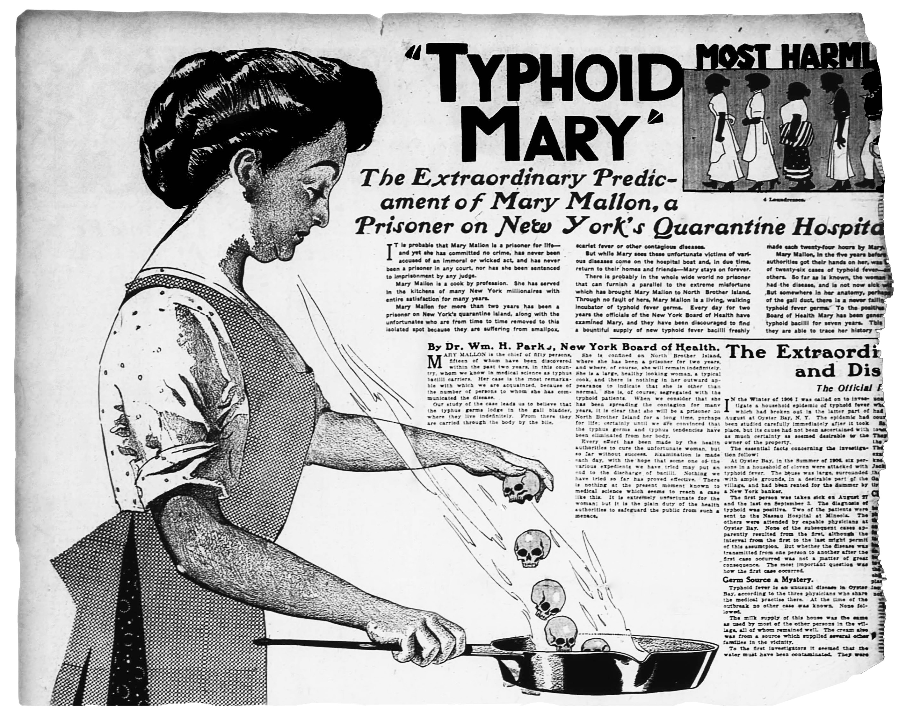
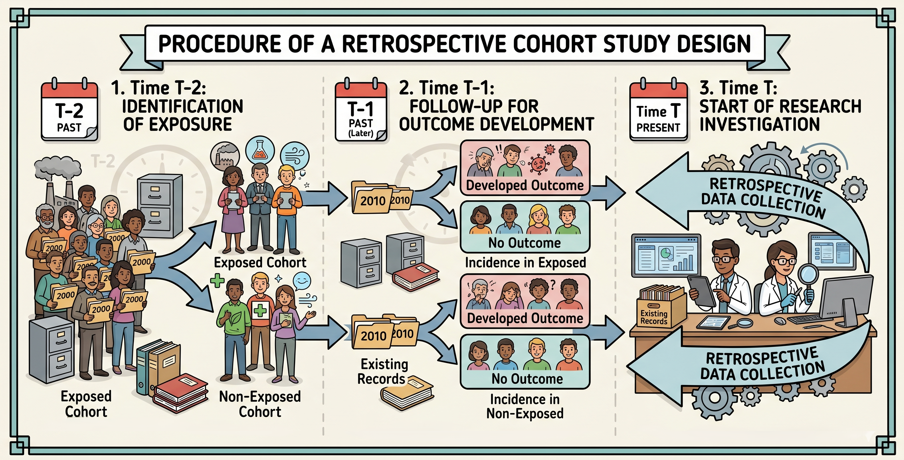
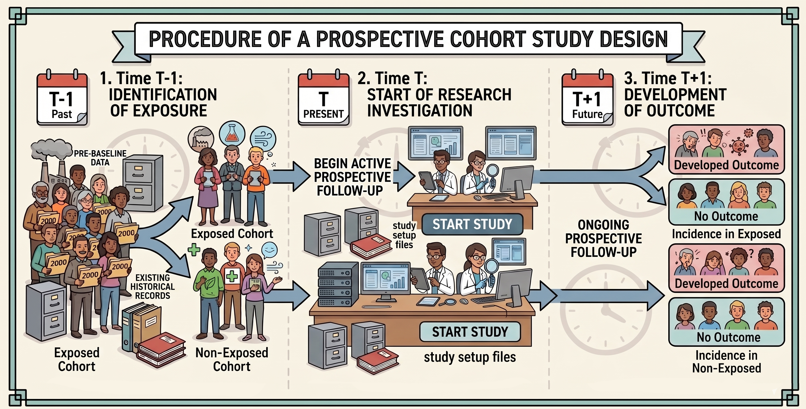
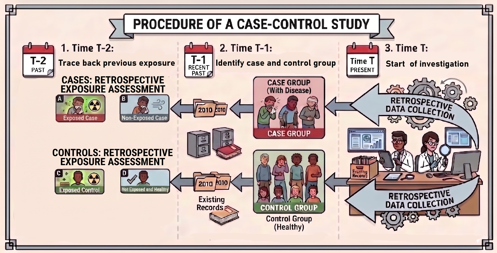
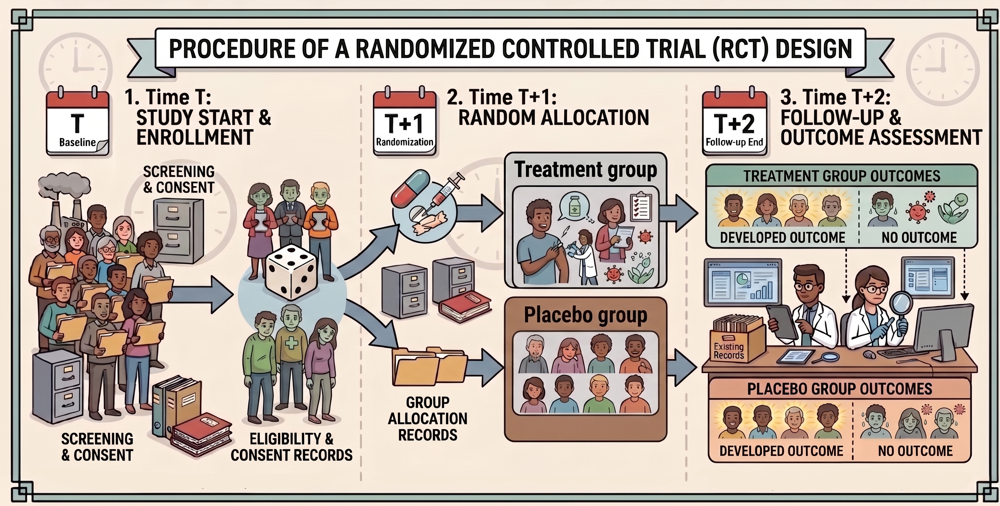

## Mary Mallon

> *"I never had typhoid in my life, and have always been healthy. Why should I be chased like a convicted criminal?"*  
> — **Mary Mallon**

::: {.columns}

::: {.column width="45%"}

:::

::: {.column width="55%"}

- Linked to 51 typhoid infections and 3 deaths in the early 1900s.
- Identified as an asymptomatic carrier.
- Transformed modern epidemiological contact tracing, quarantine protocols, and medical ethics.

:::

:::

## What Is Epidemiology?

**Definition**

The study of the **distribution** and **determinants** of health-related states or events in specified **populations**, and the application of this study to the control of health problems.

Common questions epidemiologists ask:

::: {.columns}

::: {.column width="50%"}
- Who gets sick?
- When do they get sick?
- Where do they get sick?
- How do they get sick?
- Why do they get sick?
- How can we prevent illness?
:::

::: {.column width="50%"}

:::

:::

## Epidemiological Tools

Based on these core questions, epidemiological study designs fall into three primary categories:

- **Descriptive epidemiology**: Characterizes the distribution of disease in a population by person, place, and time.
- **Analytic epidemiology**: Evaluates hypotheses regarding the determinants of disease and the relationship between exposures and outcomes.
- **Experimental epidemiology**: Evaluates the efficacy of preventive or therapeutic interventions by manipulating exposure status and tracking outcomes.

## Describing Disease Patterns

## Descriptive Study Designs

- **Case study**
  - Common tools: Patient interviews and clinical records
  - Purpose: Investigate disease etiology in-depth and identify potential risk factors
- **Cross-sectional study**
  - Common tools: Cross-sectional surveys
  - Purpose: Estimate disease prevalence and evaluate associations with risk factors at a single point in time
- **Ecological study**
  - Common tools: Vital statistics and public health registries
  - Purpose: Evaluate population-level disease trends and aggregate exposure patterns

## Key Measures of Disease Frequency

- **Prevalence** ≈ Proportion of a group with the condition *at a specific point or period in time*

:::{.hide}
$$
\small
\text{Prevalence} = \frac{\text{Number of all existing cases (new and old) at a specific time}}{\text{Total population at that specific time}}
$$
:::

- **Incidence** ≈ Rate of *new* disease occurrences within a population over a given period

:::{.hide}
$$
\small
\text{Incidence Rate} = \frac{\text{Number of new cases arising during a specific time period}}{\text{Total population at risk during that time period}}
$$
:::

## Understanding Associations

- **Cohort study**
  - Common tools: Longitudinal health records, prospective cohort recruitment
  - Approach: Classify by **exposure status**, then follow participants over time to observe disease incidence
- **Case-control study**
  - Common tools: Medical charts and registry records
  - Approach: Classify by **outcome status**, then assess prior exposures retrospectively

## Key Measures of Association

::: {.columns}

::: {.column width="50%"}
**Relative Risk (RR)**

:::{.hide}

$$
\begin{aligned}
\text{Risk} &= \frac{\text{Events}}{\text{Total at Risk}} \\
\text{RR} &= \frac{\text{Risk}_{\text{exposed}}}{\text{Risk}_{\text{unexposed}}}
\end{aligned}
$$

:::

*Question addressed:* "How many times higher is the disease risk in the exposed group compared to the unexposed group?"
:::

::: {.column width="50%"}
**Odds Ratio (OR)**

:::{.hide}

$$
\begin{aligned}
\text{Odds} &= \frac{\text{Events}}{\text{Non-Events}} = \frac{p}{1 - p} \\
\text{OR} &= \frac{\text{Odds}_{\text{exposed}}}{\text{Odds}_{\text{unexposed}}}
\end{aligned}
$$

:::

*Question addressed:* "How many times higher are the odds of exposure among cases compared to controls?"
:::

:::

**Interpreting the Metric ($RR$ or $OR$):**

-  $= 1.0$ : No association (exposure does not alter risk or odds)
-  $> 1.0$ : Positive association (exposure increases risk or odds; harmful)
-   $< 1.0$ : Negative association (exposure decreases risk or odds; protective)

## Cohort Studies

**Cohort**

A group of individuals who share common characteristics or exposures, followed over a defined observation window.

**Cohort Studies Study Framework**

1. Identify a defined population cohort:
   - Comparable demographic characteristics (e.g., age, sex)
   - Contrasting **exposure profiles** (e.g., smokers vs. non-smokers)
2. Follow participants prospectively over time to monitor who develops the outcome of interest (e.g., lung cancer).

## Retrospective Cohort Study

Assesses historical records to ascertain past exposure status and subsequent outcome status.

1. Classify participants by historical exposure status (exposed vs. unexposed).
2. Determine subsequent disease outcomes that developed following the exposure window.

{width=65%}

## Prospective Cohort Study

Enrolls participants based on current exposure status, then follows them longitudinally forward in time.

1. Identify exposed and unexposed cohorts free of the outcome at baseline.
2. Follow cohorts prospectively to measure disease incidence over time.

{width=65%}

## Case-Control Study

**Case-Control Study Study Framework**

1. Select two groups based on clinical outcome:
   - **Cases**: Individuals with the disease (e.g., lung cancer)
   - **Controls**: Comparable individuals without the disease (e.g., cancer-free)
2. Evaluate and compare past exposure history between both groups.

{width=60%}

## Comparison of Observational Designs

| Feature | Cohort Study | Case-Control Study |
|:---|:---|:---|
| Starting Point | Exposure status | Outcome / disease status |
| Direction of Inquiry |  Forward (Exposure $\rightarrow$ Outcome)  |  Backward (Outcome $\rightarrow$ Exposure)  |
| Primary Measure |  Relative Risk (RR)  |  Odds Ratio (OR)  |
| Best Suited For | Rare exposures | Rare diseases |
| Directly Measures Incidence? | Yes | No |

# Experimental Epidemiology

## Randomized Controlled Trial

**Randomized Controlled Trial (RCT) Study Framework**

1. Enroll eligible participants meeting defined inclusion/exclusion criteria.
2. Randomly assign participants to either an **intervention group** (e.g., active drug) or a **control group** (e.g., placebo or standard of care).
3. Follow participants longitudinally to evaluate differences in clinical outcomes and determine intervention efficacy.

{width=55%}

## Hierarchy of Epidemiological Evidence

::: {.columns}

::: {.column width="40%"}

::: {.incremental .hide}
1. Randomized Controlled Trials (RCTs)
2. Cohort Studies
3. Case-Control Studies
4. Case Reports & Case Series
:::

:::

::: {.column width="58%"}

**Higher-Tier Evidence:**

- Stronger capacity to establish causality
- Enhanced control of confounding variables
- Lower susceptibility to selection and recall bias

**Lower-Tier Evidence:**

- Faster, lower cost, and easier implementation
- Ideal for exploratory hypothesis generation
- Valuable for rare conditions or when randomization is unethical

:::

:::