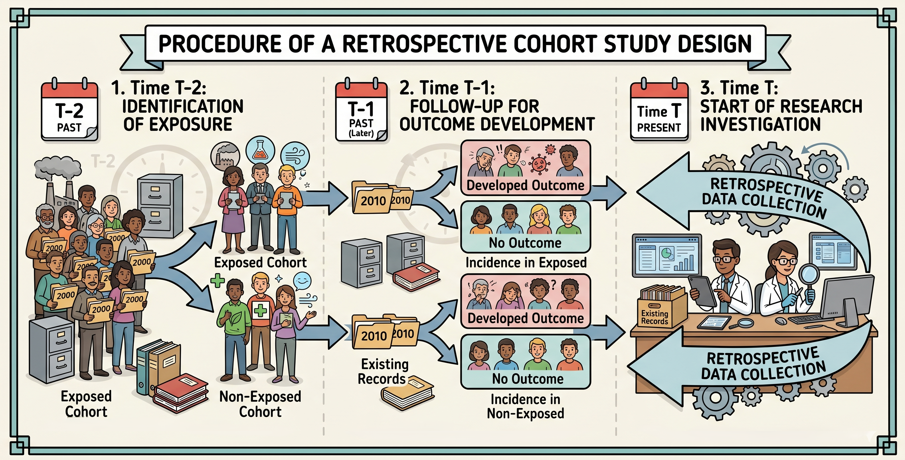
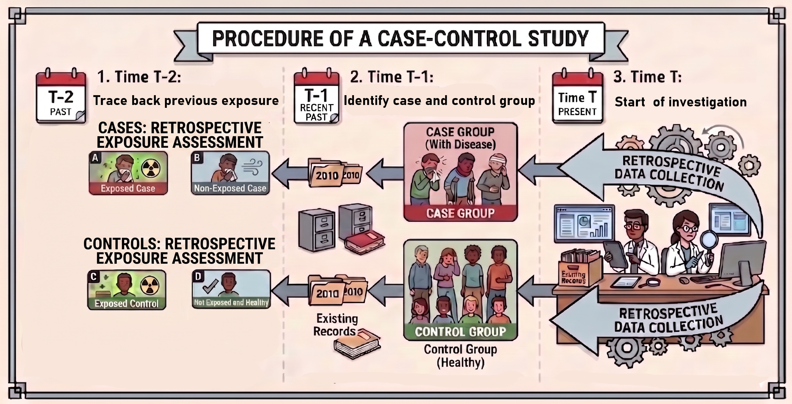

# Observational Study Designs in Health Data

## Overview of observational studies

```{text}
Unit of Observation:
 ├── Group/Population Level ──> Ecological Study
 └── Individual Level
      ├── Outcome-to-Exposure (Retrospective) ──> Case-Control Study
      └── Exposure-to-Outcome (Longitudinal)  ──> Cohort Study
```

The observational data study was categorized by

- Unit of observation
- Direction of temporal tracking.

# Population Level study

## Ecological Study

- Unit of observation: group or population
- Data Source: Government statistics, health surveillance
- Common analytical framework: Poisson/Negative binomal regression

**Ecological Fallacy**

- Inappropriately inferring an individual-level association from group-level aggregated data.

## Key measures in disease descriptions

- **Prevalence** ≈ how common the disease is *right now* in a group  

$$
\text{Prevalence} = \frac{\text{Number of ALL existing cases (new + old) at a specific time}}{\text{Total population at that specific time}}
$$

- **Incidence** ≈ how many *new* cases appear over a period of time  

$$
\text{Incidence Rate} = \frac{\text{Number of NEW cases during a specific time period}}{\text{Population at risk during that time period}}
$$

## In class activity

Skim through the Journal article [The association of arsenic exposure with mortality due to cancer, diabetes, Alzheimer's and congenital anomalies using Poisson regression](https://www.nature.com/articles/s41598-023-42744-4)

Answer the following question: 

- What is the surveillance periord? <span class="hide"> 2016–2020 </span>
- What is the sample size? <span class="hide"> 8042 Deaths </span>
- What statistical methods is used <span class="hide"> Poisson regression </span>
- Is there any comparision group? <span class="hide"> No </span>
- The study claim it's an association or causation? <span class="hide"> Association </span>
- What are the outcome measures ? <span class="hide"> Incidence rate </span>
- How does the authors report the association or causation? <span class="hide"> Relative risk </span>

# Individual Level study

## Key measures in epidemiology

:::{.columns}

:::{.column}
- **Relative risk (RR)** 

$$
\begin{aligned}
\text{Risk} & = \frac{\text{Events}}{\text{Total Everyone}} \\
\text{RR} & = \frac{\text{Risk}_{\text{exposed}}}{\text{Risk}_{\text{unexposed}}}
\end{aligned}
$$

Question answered: "How many times more likely is the event in the exposed group?"
:::

:::{.column}

**Odds ratio (OR)** 
 
$$
\begin{aligned}
\text{Odds} & = \frac{\text{Events}}{\text{Non-Events}} = \frac{p}{1 - p} \\
\text{OR} & =  \frac{\text{Odds}_{\text{exposed}}}{\text{Odds}_{\text{unexposed}}}
\end{aligned}
$$

Question answered: "How many times higher are the odds of the event in the exposed group?"

:::

:::

- Metric = 1.0: No association (exposure does not change the risk/odds).
- Metric > 1.0: Harmful exposure (higher risk/odds in the exposed group).
- Metric < 1.0: Protective exposure (lower risk/odds in the exposed group).

## Cohort study

**Cohort**

A group of people who share a common characteristic or experience within a defined period of time.

**Idea**

1. Select a group of people (cohort)
   1. with shared similar characteristics (Age, sex, etc.)
   2. with different **exposures** (e.g., smoking vs. non-smoking)
2. Follow them over time to see who develops the disease of interest (e.g., lung cancer).

- Data Source: EHR
- Common analytical framework: Logistic regression, machine learning models 

## Retrospective cohort study

Looking back from the history of the cohort to determine exposure status and  outcome.

1. Find out who were exposed and who were not exposed in the past.
2. Find out who develops the disease of interest after the exposure.

{width=65%}


## Case control study

1. We select a group of people with 
   - similar characteristics (e.g., age, sex)
   - with different **disease** (e.g., cancer vs. non-cancer), 
2. Check what kind of exposure they had before the disease

{width=65%}


## Comparison 

| Feature                |            Cohort            | Case-Control                  |
|------------------------|------------------------------|-------------------------------|
| Starting Point         | Exposure status              | Disease status (Outcome)      |
| Direction of Inquiry   | Forward (Exposure → Outcome) | Backward (Outcome → Exposure) |
| Primary Metric         | Relative Risk (RR)           | Odds Ratio (OR)               |
| Ideal Use Case         | Rare exposures               | Rare diseases                 |
| Can measure incidence? | Yes                          | No                            |

# Workshop: cohort study

## Scenario: A suspected outbreak

:::{.columns}

:::{.column}
**Presenting issue**

A small community that relies on two drinking-water sources, Water Source A and Water Source B. Several residents develop disease after directly drinking water.
:::

:::{.column}
**Questions**

Investigators want to know whether living near one water source increases the risk of infection. 
:::

:::

{width=70%}

## Activity instructions

In a cohort study, we follow a specific population based on their exposure status to observe their future probability of developing a disease.

1. **Everyone in the class:** show only the card back (Water Source) and hide the face.
2. **Investigation**: leave your seat and find $N$ **residents from Area A** and $N$ **residents from Area B**.
3. Once you find them, ask them to *reveal* their card faces and record whether they are infected (Red card).
4. Record your data in the table below in R:

| Cohort Study | Infected (Red) | Healthy (Black) |
| :--- | :---: | :---: |
| **Water Source A (Exposed = $N$)** | a | b |
| **Water Source B (Unexposed = $N$)** | c | d |


## Interpretation of cohort study

The fundamental question we can answer is:

> Compared with the **unexposed** group, how likely is the **exposed** group to develop the disease (outcome)?

To answer this, we need to know

1. How likely is the outcome to occur in the unexposed group? (Risk)
2. How likely is the outcome to occur in the exposed group? (Risk)
3. Calculate the ratio of 2. to 1. (Relative Risk)

---

```{r}
#| echo: true
#| eval: true
# Enter the data (a, b, c, d) you collected from your Cohort Study
a <- 15  # Number of infected in Area A (example)
b <- 3  # Number of healthy in Area A (example)
c <- 2  # Number of infected in Area B (example)
d <- 10  # Number of healthy in Area B (example)

# Calculate the Risk (Incidence)
risk_A <- a / (a + b)
risk_B <- c / (c + d)

# Calculate Relative Risk (RR)
RR <- risk_A / risk_B
cat("Relative Risk (RR) of the Cohort Study:", round(RR, 2), "\n")

```


**Discussion**

Current methods is the simplest way to estimate the RR. However, some obvious pitfall includes

- Cannot incorporate other control variables (e.g. sex, age, etc ...) 
- Cannot get a confidence interval to perform inference test.

## Generalized linear model

Helper function: 

Transform contingency table to proper long table with age as confounder
```{r}
#| echo: true
#| eval: true
# Expand 2x2 counts into individual patient rows
cohort_data <- data.frame(
  exposure = factor(c(rep("A", a + b), rep("B", c + d)), levels = c("B", "A")),
  infected = c(rep(1, a), rep(0, b), rep(1, c), rep(0, d))
)

# Simulate a confounder: older age increases both exposure to A and infection risk

set.seed(42)
cohort_data$age <- round(rnorm(nrow(cohort_data), mean = 45, sd = 5) + 
                         ifelse(cohort_data$exposure == "A" & cohort_data$infected == 1, 5, 0))

head(cohort_data)
```

## Poisson Regression (Directly Estimating RR)

- Estimate Relative Risk with covariate adjustment through Poisson regression


$$
\ln(P(Y =  1 \mid X)) = \beta_0 + \beta_1 \cdot \text{Exposure} + \sum \beta_k X_k
$$

Exponentiating $\beta_1$ yields the Relative Risk:

$$
\text{RR} = e^{\beta_1}
$$

##

:::{.columns}


:::{.column}
```{r}
#| echo: true
#| eval: true
#| message: false
#| warning: false

library(sandwich)
library(lmtest)

# Fit Modified Poisson Model
poisson_model <- glm(infected ~ exposure + age, 
data = cohort_data, family = poisson(link = "log"))

summary(poisson_model)

```

:::

:::{.column}

```{r}
#| echo: true
#| eval: true
#| message: false
#| warning: false

# Robust Sandwich Standard Errors
robust_se <- coeftest(poisson_model, 
vcov = vcovHC(poisson_model, type = "HC0"))

# Extract adjusted RR and 95% CI
rr_est <- exp(robust_se["exposureA", "Estimate"])
rr_ci  <- exp(coef(poisson_model)["exposureA"] +
 c(-1.96, 1.96) * 
 robust_se["exposureA", "Std. Error"])

# Printing results
cat("Adjusted Relative Risk (Poisson):", 
round(rr_est, 2), 
", 95% CI: [", round(rr_ci[1], 2), ",", 
round(rr_ci[2], 2), "]\n")
```


- Poisson regression overestimates standard errors in this example (as outcome is 1 or 0)
- Robust sandwich standard errors (sandwich and lmtest packages) to produce valid 95% confidence intervals.
:::

:::

## Logistic Regression (Estimating Odds Ratios)

Alternative model is the logistic regression model

Modle the log-odds using a logit link:

$$
\ln\left(\frac{P(Y = 1)}{1 - P(Y = 1)}\right) = \beta_0 + \beta_1 \cdot \text{Exposure} + \sum \beta_k X_k
$$

Exponentiating $\beta_1$ yields the  Odds Ratio:

$$
\text{OR} = e^{\beta_1}
$$

##

```{r}
#| echo: true
#| eval: true
# Fit Logistic Regression Model
logistic_model <- glm(infected ~ exposure + age, data = cohort_data, family = binomial(link = "logit"))

# Extract adjusted OR and 95% CI
or_est <- exp(coef(logistic_model)["exposureA"])
or_ci  <- exp(confint.default(logistic_model)["exposureA", ])

summary(logistic_model)

cat("Adjusted Odds Ratio:", round(or_est, 2), "95% CI: [", round(or_ci[1], 2), ",", round(or_ci[2], 2), "]")
```

## OR v.s. RR 

- Historical issue:
  - Poisson regression does not guarntee a stable answer
  - Over-estimation (i.e. in our example we need additional package solving this)
  - Commercial softwares (SAS,SPSS) default is logistic regression

Nowaday selection of using OR (logistic regression) or RR (Poisson regression) in cohort study based on the consideraion

- RR-Poisson Regression:  Golden standard for top-tier journals, common disease
- OR-Logistic Regression: Case-control study, prediction modeling (AI) rare disease

##  OR approximate to RR
Let's recall the formulas using our $2 \times 2$ table counts ($a$ = Exposed Cases, $b$ = Exposed Controls, $c$ = Unexposed Cases, $d$ = Unexposed Controls).

:::{.columns}

:::{.column}

**Relative Risk (RR):** 
$$ 
\small
RR = \frac{\text{Risk in Exposed}}{\text{Risk in Unexposed}} = \frac{\frac{a}{a+b}}{\frac{c}{c+d}}
$$


:::

:::{.column}

**Odds Ratio (OR):** 

$$
\small
OR = \frac{\text{Odds in Exposed}}{\text{Odds in Unexposed}} = \frac{\frac{a}{b}}{\frac{c}{d}} = \frac{a \times d}{b \times c}
$$

:::

:::

If a disease is extremely rare (e.g., 1 in 10,000 people), the number of sick  ($a$ and $c$) is incredibly tiny compared to the healthy people ($b$ and $d$).

If $a$ is vanishingly small, then adding it to $b$ barely changes anything. Therefore the following approximation holds
$$ 
\small
\begin{aligned}
a \ll b \implies & a + b \approx b \\
c \ll d \implies & c + d \approx d 
\end{aligned}
$$

## Summary

| Context | Recommend methods | Why? |
| --- | -- | ------|
| **Outcome is Rare ($<5\% - 10\%$)** | **Logistic Regression** | $\text{OR} \approx \text{RR}$; computation is fast, robust, and universally accepted. |
| **Outcome is Common ($>10\%$) in a Cohort** | **Poisson Regression** | Directly yields an interpretable Relative Risk without exaggerating effect size. |
| **Prediction Modeling / Risk Calculators / Case control study** | **Logistic Regression** | Guaranteed to bound individual risk estimates within $[0, 1]$. |
