# Introduction to Network Science

## Network Science?

* **Definition:** An interdisciplinary field studying the topology, dynamics, and interactions of complex systems through graph theory.
* Focuses on organizing principles across diverse domains without requiring advanced pure mathematics or algorithms.


::: {.columns}
::: {.column width="53%"}
* **Foundational Literature:** 
  * @barabasi2013network, *Network Science* 
  * @newman2018networks, *Networks*
  * @menczer_fortunato_davis_2020, *A First Course in Network Science* 
:::

::: {.column width="44%"}
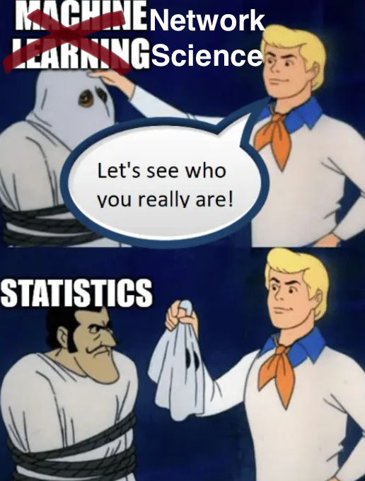{width=65% fig-align="center"}
:::

:::

## Mathematical Formalism

A network is mathematically defined as a graph $G = (V, E)$:

* **Vertex / Node Set:** $V = \{v_1, v_2, \dots, v_N\}$, where $|V| = N$ is the network size.
* **Edge / Link Set:** $E = \{(u, v) \mid u, v \in V\}$, where $|E| = M$ is the total edge count.

::: {.callout-note}
### Notation
In directed graphs, an edge $e = (u, v)$ points from source $u$ to target $v$ (often termed a **directed arc**).
:::

## Adjacency Matrix Representation

A graph $G$ with $N$ vertices is represented by an $N \times N$ adjacency matrix $A$:

$$
A_{ij} = 
\begin{cases} 
1 & \text{if } (i, j) \in E \\
0 & \text{otherwise}
\end{cases}
$$

::: {.columns}
::: {.column width="50%"}
* **Undirected Networks:**
  * Symmetric: $A_{ij} = A_{ji}$
  * Reciprocal interaction
* **Directed Networks:**
  * Asymmetric: $A_{ij} \neq A_{ji}$
  * $A_{ij} = 1 \implies i \to j$
:::

::: {.column width="50%"}
* **Weighted Networks:**
  * Entries $W_{ij} \in \mathbb{R}$ quantify tie strength, traffic, or frequency.
* **Unweighted Networks:**
  * Entries are strictly binary $A_{ij} \in \{0, 1\}$.
:::
:::

## Networks in Different Disciplines

| Network Type | Nodes ($V$) | Edges ($E$) |
|:---|:---|:---|
| **Correlation Graph** | Psychological traits / Symptoms | Correlation coefficient |
| **Partial Correlation / GGM** | Variables / Dimensions | Conditional correlation |
| **Structural Equation Model** | Latent / Observed factors | Covariance / Directed paths |
| **Causal DAG** | Interventions / Variables | Directed causal mechanisms |
| **Social Network** | Individuals / Organizations | Friendship, communication, ties |
| **Spatial Network** | Cities, intersections, landmarks | Roads, transit, distance |

## Moreno's Sociograms (1934)

* Jacob L. Moreno @moreno1934shall pioneered social network visualization using **sociograms**.
* Studied classroom sociability (e.g., asking children to choose peers they would prefer to sit next to).

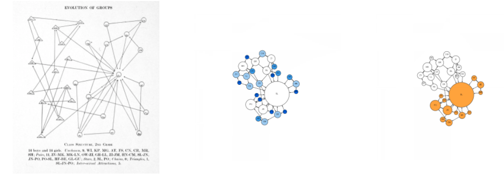{width=100% fig-align="center"}

# Micro-Level Metrics: Centrality

## Degree Centrality

* **Intuition:** Quantifies how well-connected a node is by counting its direct connections.
* **Undirected Graph:**
  $$
  \small
  k_i = \sum_{j=1}^{N} A_{ij}
  $$

* **Directed Graph:**
  $$
  \small
  k_i^{\text{in}} = \sum_{j=1}^{N} A_{ji} \quad \text{(Inward endorsements / popularity)}
  $$
  $$
  \small
  k_i^{\text{out}} = \sum_{j=1}^{N} A_{ij} \quad \text{(Outward activity / gregariousness)}
  $$

## Application: Information Flow & Governance

::: {.columns}
::: {.column width="50%"}
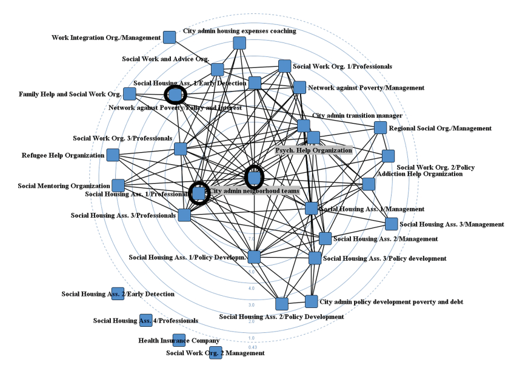{width=100% fig-align="center"}
:::

::: {.column width="50%"}
*  @kenis2020back analyzed municipality information flows.
* Without active governance interventions, communication networks spontaneously polarize into **core-periphery structures**, leaving peripheral actors uninformed.
:::
:::

## Eigenvector Centrality

* **Concept:** A node is influential if it is connected to *other highly influential nodes* (recursive importance).
* **Mathematical Definition:**
  $$
  \lambda x_i = \sum_{j=1}^{N} A_{ij} x_j \iff A x = \lambda x
  $$
* By the **Perron–Frobenius theorem**, for a non-negative, irreducible matrix $A$, the dominant eigenvalue $\lambda_1$ corresponds to an eigenvector $x^*$ whose entries are all non-negative ($x_i \ge 0$).
* $x_i^*$ represents the eigenvector centrality score of node $i$.

## Empirical Example: Lifespan Risk Trajectories

::: {.columns}
::: {.column width="55%"}
* @hsu2023network mapped risk factors and triggers across different age cohorts.
* Eigenvector centrality identifies which psychological and environmental stressors act as core drivers across developmental stages.
:::

::: {.column width="45%"}
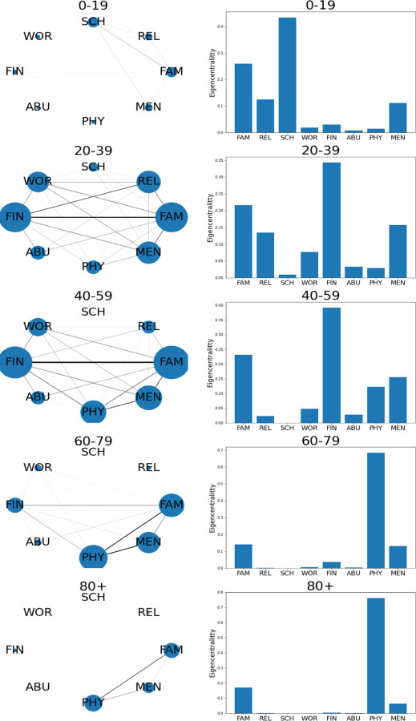{width=60% fig-align="center"}
:::
:::

## Betweenness Centrality

* **Concept:** Measures how often a node falls on the shortest path (geodesic) between other pairs of nodes—acting as a bridge or gatekeeper.

$$
C_B(i) = \sum_{s \neq i \neq t \in V} \frac{\sigma_{st}(i)}{\sigma_{st}}
$$

* $\sigma_{st}$: Total number of shortest paths between node $s$ and node $t$.
* $\sigma_{st}(i)$: Number of those shortest paths passing through node $i$.
* **Applications:** Information brokerage (Burt's structural holes), organizational gatekeeping, viral super-spreaders in epidemiological models.

## Computing Centrality in R and Python

::: {.panel-tabset}
### R (`sna`)
```r
library(sna)

# Create a random directed graph (10 nodes)
dat <- rgraph(10)

# In-degree, out-degree, and total degree
degree(dat, cmode = "indegree")
degree(dat, cmode = "outdegree")

# Eigenvector centrality
evcent(dat)

# Betweenness centrality
betweenness(dat)
```

### Python (`networkx`)
```python
import networkx as nx

G = nx.DiGraph()
nx.add_path(G, [0, 1, 2, 3])

# Degrees
in_deg = dict(G.in_degree())
out_deg = dict(G.out_degree())

# Eigenvector centrality
ev = nx.eigenvector_centrality(G)

# Betweenness centrality
bw = nx.betweenness_centrality(G)
```
:::

# Meso-Level Metrics: Communities & Clustering

## Detection vs. Clustering

* **Local Clustering:** Evaluates local connectivity density—specifically, the probability that two neighbors of a node are themselves linked.
* **Community Detection:** Partitions the network into modular sub-units with dense internal connections and sparse inter-group connections.

::: {.columns}
::: {.column width="50%"}
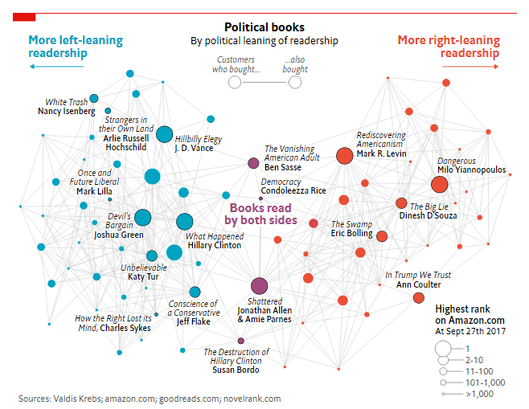{width=70% fig-align="center"}

:::

::: {.column width="50%"}
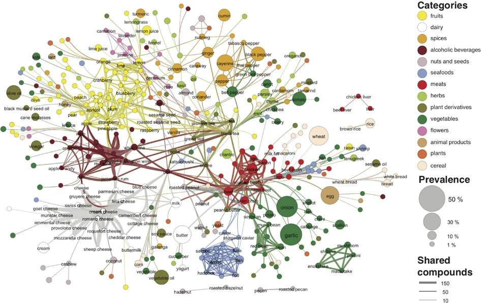{width=70% fig-align="center"}
:::
:::

## Local Clustering Coefficient

The clustering coefficient $C_i$ of node $i$ measures the proportion of realized ties among its $k_i$ neighbors:

$$
C_i = \frac{2 L_i}{k_i(k_i - 1)}
$$

* $L_i$: Number of links between neighbors of node $i$.
* $\frac{k_i(k_i-1)}{2}$: Maximum possible links among $k_i$ neighbors.
* **Average Clustering Coefficient:**
  $$
  \langle C \rangle = \frac{1}{N} \sum_{i=1}^{N} C_i
  $$

## Homophily & Group Boundaries

> *"Birds of a feather flock together"*

* **Definition:** Tendency of nodes to form ties with similar others (based on sociodemographics, ideology, etc.).
* **External-Internal (E-I) Index** (Krackhardt & Stern):
  $$
  \text{E-I} = \frac{E_{\text{external}} - E_{\text{internal}}}{E_{\text{external}} + E_{\text{internal}}}
  $$
  * Range: $[-1, +1]$
  * $-1$: Perfect homophily (all links within-group).
  * $+1$: Perfect heterophily (all links cross-boundary).

## Community Detection in Code

::: {.panel-tabset}
### R
```r
library(igraph)

g <- sample_gnp(20, 0.15)

# Louvain modularity optimization
comm_louvain <- cluster_louvain(as.undirected(g))
membership(comm_louvain)

# Hierarchical community detection (walktrap)
comm_walktrap <- cluster_walktrap(g)
```

### Python
```python
import networkx as nx

G = nx.erdos_renyi_graph(20, 0.15)

# Louvain Community Detection
communities = nx.community.louvain_communities(G)

# Greedy Modularity
greedy_comm = nx.community.greedy_modularity_communities(G)
```
:::

# Macro-Level Metrics & Software Ecosystem

## Macro-Level Structural Dimensions

* **Distance ($d_{ij}$):** Length of the shortest path between $i$ and $j$.
* **Network Diameter ($D$):** Maximum geodesic distance across any connected pair:
  $$
  D = \max_{i, j \in V} d_{ij}
  $$
* **Average Path Length ($\langle d \rangle$):**
  $$
  \langle d \rangle = \frac{1}{N(N-1)} \sum_{i \neq j} d_{ij}
  $$
* **Effective Diameter (90th percentile):** Minimum distance that connects 90% of reachable node pairs (robust to outliers).

## The Network Analysis Software Stack

::: {.columns}
::: {.column width="33%"}
### Python
* **NetworkX:** Rapid prototyping & teaching
* **igraph-python:** High performance for large graphs
* **graph-tool:** C++ backend, high speed
* **OSMnx:** Spatial and street networks
:::

::: {.column width="33%"}
### R
* **igraph:** Comprehensive graph algorithms
* **statnet / ergm:** Statistical inference & modeling
* **qgraph / bootnet:** Psychometrics & partial correlation networks
:::

::: {.column width="33%"}
### GUI & Visualization
* **Gephi:** Interactive exploration & GPU rendering
* **Cytoscape:** Biological & multi-omics networks
:::
:::

## Summary

1. **Foundations:** Graphs represent complex relations via nodes ($V$) and edges ($E$) encoded as adjacency matrices ($A$).
2. **Micro Level:** Degree, eigenvector, and betweenness centralities reveal distinct forms of node importance (connectivity, prestige, and brokerage).
3. **Meso Level:** Clustering coefficients and homophily indices capture localized social structure and modular boundaries.
4. **Macro Level:** Path lengths and diameters characterize how efficiently information or influence traverses the system.

## Overview

- Focuses on **probabilistic graphical models** with applications in social science and psychology.
- **Key Theoretical References:**
  -   @wasserman2013all, *All of Statistics* / Causal inference literature 
  -  @hastie2009elements , *Elements of Statistical Learning*
- **Software & Implementation:**
  - @epskamp2012qgraph @epskamp2015package, and @epskamp2018estimating  psychometric network framework (`qgraph` , `bootnet`).


# Graphical Models

## What is a Graphical Model?

- A framework to represent joint dependency structures and relationships between random variables.
- Can be represented as:
  - **Directed graphs** (e.g., Bayesian networks, DAGs)
  - **Undirected graphs** (e.g., Markov Random Fields, partial correlation networks)

## In Pursuit of Causality

- Finding causal relationships without expensive Randomized Controlled Trials (RCTs) is a primary research goal.
- RCTs are often constrained by **budgets**, **ethical barriers**, and **logistics**.
- The primary aim of these network graphs is to discover **associations likely to indicate causal pathways**.

::: {.callout-caution}
### Caveat @wasserman2013all
RCT remains the gold standard. **Any** algorithmic causal discovery is an approximation reliant on structural and distributional assumptions.
:::


## Types of Network

| Network | Node | Edge Meaning |
| :--- | :--- | :--- |
| **Marginal Correlation Graph** | Variables / Factors | Marginal correlation |
| **Partial Correlation Graph** | Variables / Factors | Conditional correlation |
| **Conditional Independence Graph** | Variables / Factors | Conditional independence |
| **Causal Graph** | Variables / Factors | Directed causation |

## Marginal Correlation Networks

- The most intuitive, but least informative network representation.
- Directly transforms a correlation matrix into an undirected network:
  - An edge exists between $i$ and $j$ if $\text{corr}(i,j) \neq 0$ (typically evaluated via hypothesis testing).
  - Can use Pearson's $r$, Kendall's $\tau$, or Spearman's $\rho$.

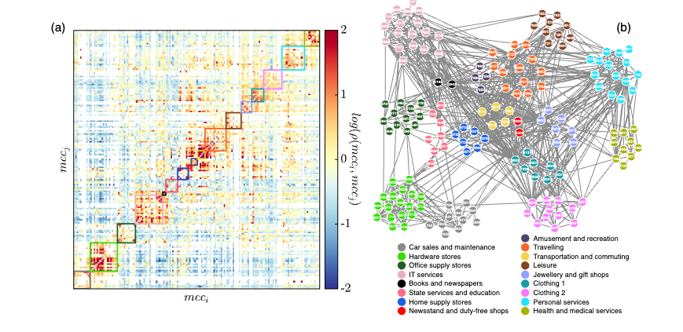{width=50% fig-align="center"}

# Partial Correlation & Conditional Independence

## The Need for Partial Correlation

- Marginal bivariate correlations can be spurious or explained away by third-party confounding variables.
- **Partial correlation** $p(X, Y \mid Z)$:
  - Correlation between residuals $\epsilon_X$ and $\epsilon_Y$ after linearly regressing $X$ on $Z$ and $Y$ on $Z$.
- Connects directly to the **precision matrix** (inverse covariance matrix):
  $$\Omega = \Sigma^{-1}$$
- The partial correlation matrix entries $R(i, j)$ are:
  $$R(i, j) = -\frac{\Omega_{i,j}}{\sqrt{\Omega_{i,i}\Omega_{j,j}}}$$

## Conditional Independence: Gaussian Case

Let variables be jointly Gaussian: $X \sim \mathcal{N}(\mu, \Sigma)$.

::: {.callout-note}
### Theorem
Suppose $X \sim \mathcal{N}(\mu, \Sigma)$. Then:
$$X_i \perp \!\!\! \perp X_j \mid X_{-(i,j)} \iff \Omega_{ij} = 0$$
:::

- In Gaussian Graphical Models (GGMs), testing for conditional independence is identical to testing if the off-diagonal elements of the precision matrix equal zero.


## Categorical / Multinomial Variables

- For binary or categorical outcomes, Poisson / log-linear representations are used.
- For two binary variables $X = (x_1, x_2)$:
  $$\log p(x_1, x_2) = \beta_0 + \beta_1 x_1 + \beta_2 x_2 + \beta_{12} x_1 x_2$$
- Parameter interpretations:
  $$\beta_{12} = \log \frac{p(0,0)p(1,1)}{p(1,0)p(0,1)}$$
- Under independence, $\frac{p(0,1)}{p(0,0)} = \frac{p(1,1)}{p(1,0)} \implies \beta_{12} = 0$.
- **Takeaway:** Conditional independence corresponds to testing if the interaction/moderation parameter is zero.


# Statistical Inference & Testing

## Common Targets of Inference

Researchers frequently need interval estimation and hypothesis testing rather than purely point estimates:

1. **Edge existence:** $A_{ij} \neq 0$
2. **Edge difference:** $A_{ij} \neq A_{jk}$
3. **Centrality differences:** Node strength, closeness, betweenness

---

## Analytical vs. Bootstrap Approaches

- **Analytical / Asymptotic Methods:**
  - Established by Tony Cai and his colleagues (@cai2013optimal,@cai2016large,@cai2017global) for Gaussian settings.
  - *Limitations:* Strictly requires Gaussianity; does not readily test centrality metrics.
- **The Bootstrap Solution:**
  - Non-parametric or parametric resampling provides empirical distributions for:
    - Edge weights against zero (or arbitrary thresholds).
    - Confidence intervals around centrality measures and rank orderings @epskamp2018estimating.


## Application: Comorbidity Networks

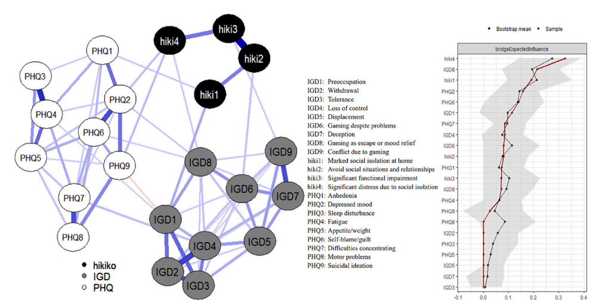{width=70% fig-align="center"}

# Computational Considerations

## Challenges with High Dimensions

Computing empirical partial correlations directly encounters barriers:

1. **Matrix Inversion:** $\Sigma^{-1}$ is unstable or non-invertible when $p \ge n$.
2. **Combinatorial Explosion:** The number of conditional independence tests grows quadratically ($\mathcal{O}(p^2)$).

## Regularization: Graphical Lasso (glasso)

- Penalizes the negative log-likelihood with an $\ell_1$-penalty to enforce sparsity:
  $$\hat{\Omega} = \arg\max_{\Omega \succ 0} \left( \ell(\Omega) - \lambda \sum_{j \neq k} |\Omega_{jk}| \right)$$
  where
  $$\ell(\Omega) = \frac{n}{2}\log|\Omega| - \frac{n}{2}\text{tr}(\Omega S_n) - \frac{nd}{2}\log(2\pi)$$
- Tuning parameter ($\lambda$) selection:
  - **Cross-Validation (CV)**
  - **Extended Bayesian Information Criterion (EBIC)**

# Empirical Applications

## Applications in Psychopathology

- Psychological symptoms can be conceptualized as interacting elements in a complex network rather than passive indicators of an unobserved latent disease entity.
:::{.columns}

:::{.column}

- **Examples:**
  - **Depression & Suicidality:** @junus2024evaluating demonstrated hopelessness scale items conditionally depend on suicide ideation.
  - **Internet Gaming Disorder (IGD):** @fong2024comorbidity identified gaming as a mood-escape mechanism directly connected to depressive mood and social withdrawal.
:::

:::{.column}
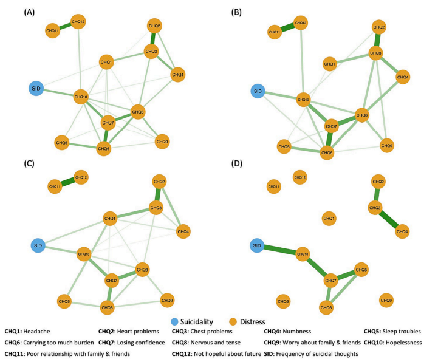{width=65% fig-align="center"}
:::
:::


# R Implementation

## Network Estimation with `bootnet`

```r
library(psychTools)
library(bootnet)
library(qgraph)

# Load sample data: Big Five Inventory (BFI)
data(bfi)
bfiSub <- bfi[, 1:25]

# 1. Marginal correlation network
Network_corr <- estimateNetwork(bfiSub, default = "cor")

# 2. Gaussian Graphical Model with EBICglasso
Network_BIC <- estimateNetwork(bfiSub, default = "EBICglasso")

# 3. Ising model for binary variables
Network_Ising <- estimateNetwork(bfiSub, default = "IsingFit")

# 4. Mixed Graphical Model (MGM) for mixed data types
Network_Mgm <- estimateNetwork(bfiSub, default = "MGM")
```


## Visualization & Centrality Testing

```r
# Plot network layout using the Fruchterman-Reingold algorithm
plot(Network_BIC, layout = "spring")

# Compute and plot centrality indices (Strength, Betweenness, Closeness)
centralityPlot(Network_BIC)

# Test for statistical difference in edge strength
differenceTest(Network_BIC, "A1", "C2", "strength")
```

# Summary & Model Selection

## Model Selection Guidelines

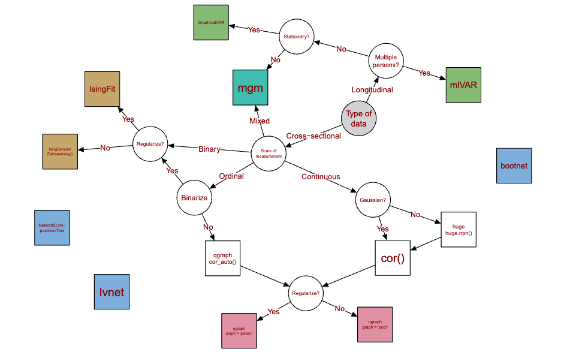{width=70% fig-align="center"}

## 

- **Continuous Gaussian variables:** Partial correlation via EBICglasso / GGM.
- **Binary variables:** Ising models via `IsingFit`.
- **Mixed variables:** Mixed Graphical Models (`mgm`).
- Note: Continuous variables do not require an arbitrary shift between correlation and partial correlation; partial correlation graphs should generally be preferred to avoid spurious correlations.


# Exponential Random Graph Models (ERGM)

## Motivation for ERGMs

- **Central Research Question:**
  > *Do individual attributes and local structural configurations drive the probability of tie formation?*
- Empirical research requires a **statistical inference framework** to:
  - Estimate effect sizes ($\beta$ / $\theta$)
  - Calculate standard errors and $p$-values
  - Control for endogenous network dependencies (e.g., reciprocity, transitivity)

## ERGM Problem Formulation

Let $Y$ be an $N \times N$ adjacency matrix of binary random variables $Y_{ij} \in \{0, 1\}$.

The general probability distribution of observing graph $y$ is:

$$
P(Y = y \mid \theta) = \frac{\exp\left(\theta^\top g(y)\right)}{\kappa(\theta)}
$$

- $g(y)$: Vector of network statistics (counts of edges, mutual dyads, triangles, node-level covariates).
- $\theta$: Model parameters / coefficients to estimate.
- $\kappa(\theta) = \sum_{y^* \in \mathcal{Y}} \exp\left(\theta^\top g(y^*)\right)$: Intractable normalizing constant summing over all $2^{\binom{N}{2}}$ possible networks.

## Local Conditional Interpretation: Change Statistics

Conditioning on the rest of the network ($Y_{-ij}$), the log-odds of a tie between $i$ and $j$ takes a logistic form:

$$
\text{logit}\left(P(Y_{ij} = 1 \mid Y_{-ij}, \theta)\right) = \theta^\top \delta(y)_{ij}
$$

where $\delta(y)_{ij}$ is the **change statistic**:

$$
\delta(y)_{ij} = g\left(y_{ij}^{+}\right) - g\left(y_{ij}^{-}\right)
$$

- $y_{ij}^{+}$: The network with edge $(i, j)$ present.
- $y_{ij}^{-}$: The network with edge $(i, j)$ absent.

## Structural Elements of $g(y)$
:::{.columns}

:::{.column width=67%}

1. **Dyadic Independent Terms:**
   - Density: Number of edges $\sum y_{ij}$
   - Nodal Covariates: Main effects of sender/receiver attributes (e.g., age, gender)
   - Dyadic Covariates: Homophily / absolute difference $|X_i - X_j|$

2. **Dyadic Dependent Terms (Endogenous Structures):**
   - Reciprocity: Mutual ties $\sum y_{ij} y_{ji}$
   - Triadic Closure: Triangles, transitive ties
   - Degree Distributions: Star terms, Geometrically Weighted Degree (GWESP, GWDegree)


:::

:::{.column width=30%}

{width=80% fig-align="right"}

:::

:::


# Practical Estimation in R (`statnet`) @handcock2008statnet


## Dataset: Bott (1928) Children Imitation

- Adopted from @robins2007introduction
- Observational study of children's playgroup behaviors (Bott, 1928).
- A directed edge from $i \to j$ indicates child $i$ imitated child $j$.
- Analyzed in Bott's 4th observation group ($N = 11$, total possible directed dyads $= 11 \times 10 = 110$).

```r
library(networkdata)
library(statnet)
data(bott)

# Inspect network and observed edge count
summary(bott[[4]] ~ edges)
## edges 
##    35
```

## Baseline Model: Bernoulli Random Graph

```r
bottmodel.01 <- ergm(bott[[4]] ~ edges)
summary(bottmodel.01)
```

```
## ==========================
## Monte Carlo MLE Results:
##       Estimate Std. Error MCMC %  p-value    
## edges  -0.7621     0.2047      0 0.000313 ***
## ---
## Residual Deviance: 137.6 on 109 degrees of freedom
## AIC: 139.6   BIC: 142.3
```

- **Interpretation:**
  $$\text{logit}(p) = -0.7621 \implies p = \frac{1}{1 + e^{0.7621}} \approx 0.318 = \frac{35}{110}$$
- This recovers the observed density directly via maximum likelihood.

## Adding Nodal Attributes (In-Degree Covariate)

*Hypothesis:* Are older children imitated more frequently (higher in-degree)?

```r
bottmodel_node <- ergm(bott[[4]] ~ edges + nodeicov('age.month'))
summary(bottmodel_node)
```

```
##                    Estimate Std. Error MCMC % p-value   
## edges              -2.89853    0.96939      0 0.00345 **
## nodeicov.age.month  0.05225    0.02272      0 0.02340 * 
```

- **Conditional Log-Odds:**
  $$\text{logit}(P(Y_{ij}=1)) = -2.90 + 0.052 \times (\text{Age of child } j)$$
- **Effect:**
  - For a 36-month-old target: $-2.90 + 0.052(36) = -1.028 \implies P \approx 0.263$
  - For a 48-month-old target: $-2.90 + 0.052(48) = -0.404 \implies P \approx 0.400$

## Adding Endogenous Structural Terms: Triangles

Triangles quantify **transitivity** and local clustering:

```r
bottmodel_triangle <- ergm(bott[[4]] ~ edges + triangle)
summary(bottmodel_triangle)
```

```
##          Estimate Std. Error MCMC % p-value
## edges    -0.55772    0.58201      0   0.340
## triangle -0.05674    0.15330      0   0.712
```

- **Conditional Log-Odds:**
  $$\text{logit}(P(Y_{ij} = 1 \mid Y_{-ij})) = -0.558 - 0.057 \times (\Delta \text{Triangles})$$
  - Tie creates 0 triangles: $-0.558 - 0.057(0) = -0.558$
  - Tie creates 1 triangle:  $-0.558 - 0.057(1) = -0.615$
  - Tie creates 2 triangles: $-0.558 - 0.057(2) = -0.672$

# Estimation & Model Diagnostics

## Why Standard Logistic Regression Fails

- Standard GLMs assume **independent observations** ($Y_{ij} \perp \!\!\! \perp Y_{kl}$).
- In networks with structural terms (e.g., `triangle`):
  - Whether tie $(i, j)$ forms a triangle depends on $(i, k)$ and $(k, j)$.
  - **Dyadic dependence** violates the $i.i.d.$ assumption.
- The normalizing constant $\kappa(\theta) = \sum_{y^*} \exp(\theta^\top g(y^*))$ cannot be computed analytically ($2^{\binom{N}{2}}$ states).
- **Solution:** **Markov Chain Monte Carlo Maximum Likelihood Estimation (MCMLE)** via Metropolis–Hastings sampling.

## MCMLE Diagnostics

```r
library(latticeExtra)
mcmc.diagnostics(bottmodel_triangle)
```

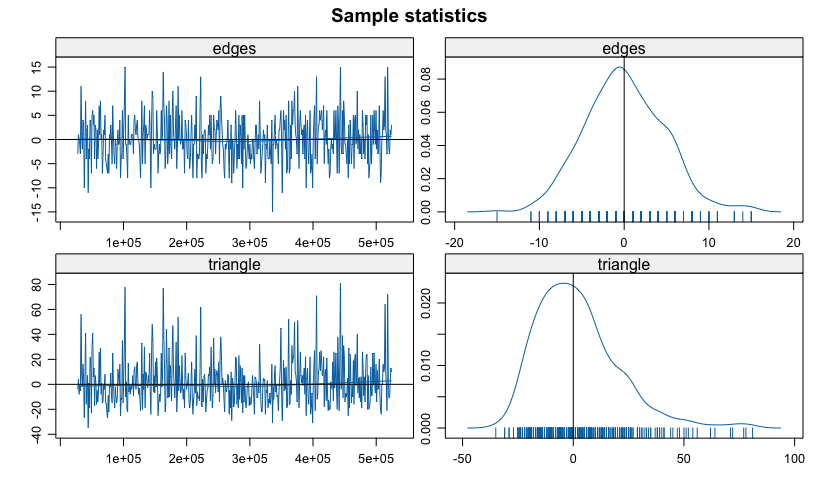{width=65% fig-align="center"}

##

- **Trace Plots:** Should fluctuate stably around zero (white noise).
- **Density Plots:** Should be centered at 0 and approximately bell-shaped.
- **Autocorrelation:** Should decay rapidly toward zero as lag increases.
- **Geweke Diagnostic:** Checks difference between early and late parts of the chain ($p > 0.05$ indicates stationary convergence).

## Model Degeneracy

::: {.callout-warning}
### Caution on Naive Triangle Terms
Models with raw `triangle` counts frequently suffer from **MCMC degeneracy**:
- The simulated chain collapses into either a completely empty graph or a complete clique.
- Standard errors blow up, or MCMLE fails to converge.
:::

- **Modern Solution:** Use geometrically weighted terms with decreasing marginal returns:
  - `gwesp` (Geometrically Weighted Edgewise Shared Partner)
  - `gwdgree` / `gwidegree` / `gwodegree`

## Goodness of Fit (GOF) 

We evaluate whether the fitted model reproduces higher-order network metrics *not explicitly parameterized*: @hunter2008goodness

```r
bottmodel_triangle_gof <- gof(bottmodel_triangle ~ model + odegree)
plot(bottmodel_triangle_gof)
```

::: {.columns}
::: {.column width="50%"}
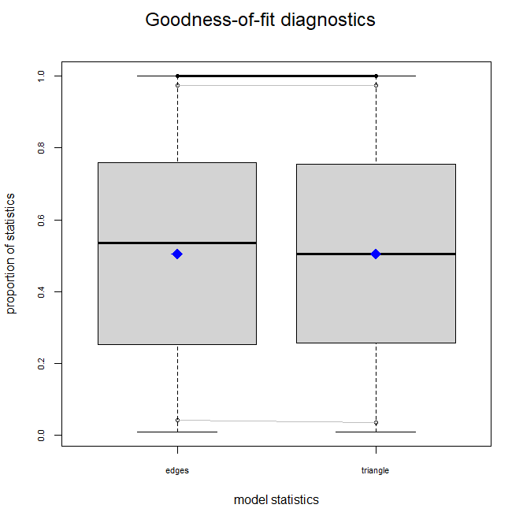{width=95%}
:::
::: {.column width="50%"}
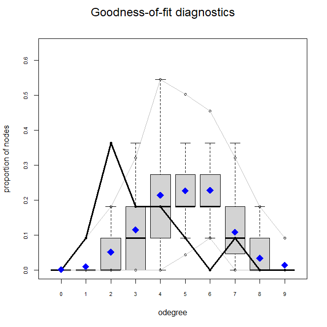{width=95%}
:::
:::

##

- Solid line = Observed network value.
- Boxplots = Values across networks simulated from fitted $\hat{\theta}$.
- If the observed line sits within the simulation intervals, the model fits well.

## Real-World Application

::: {.columns}
::: {.column width="50%"}
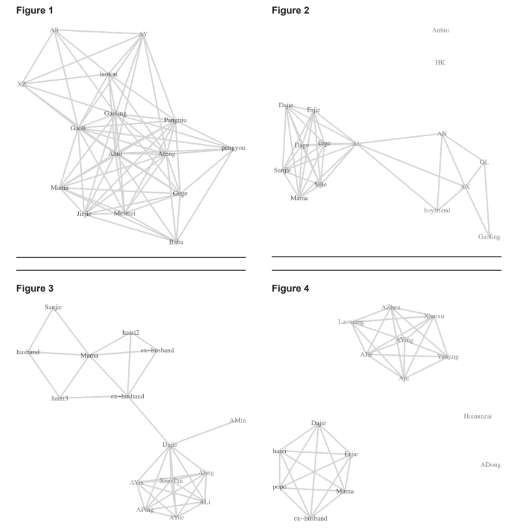{width=100% fig-align="center"}
:::

::: {.column width="50%"}
- **Network Study:** Female sex worker network in Hainan Province @yu2016transitivity.
- **Structural Findings:**
  - High transitivity and clustering within subgroups facilitated mutual safety and peer education.
  - However, customer contact networks showed structural holes due to economic competition.
:::
:::

## Summary

1. **Random Graphs as Null Models:**
   - ER graphs establish a baseline for completely random tie formation.
   - Small-world (WS) and Scale-free (BA) models highlight mechanisms producing high clustering and hubs.
2. **ERGMs for Hypothesis Testing:**
   - Model the full joint distribution of a network.
   - Change statistics evaluate individual attributes and local structural configurations simultaneously.
3. **Robust Practice:**
   - Always verify MCMC convergence (`mcmc.diagnostics`).
   - Guard against degeneracy using tapered terms (`gwesp`).
   - Confirm out-of-model fit via `gof()`.