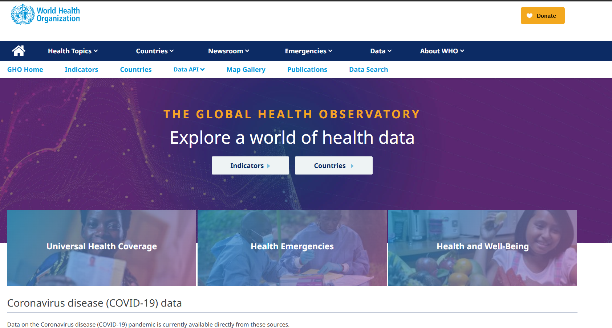
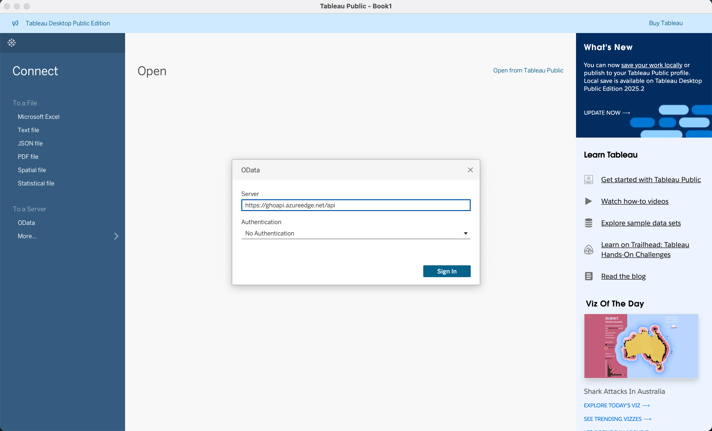
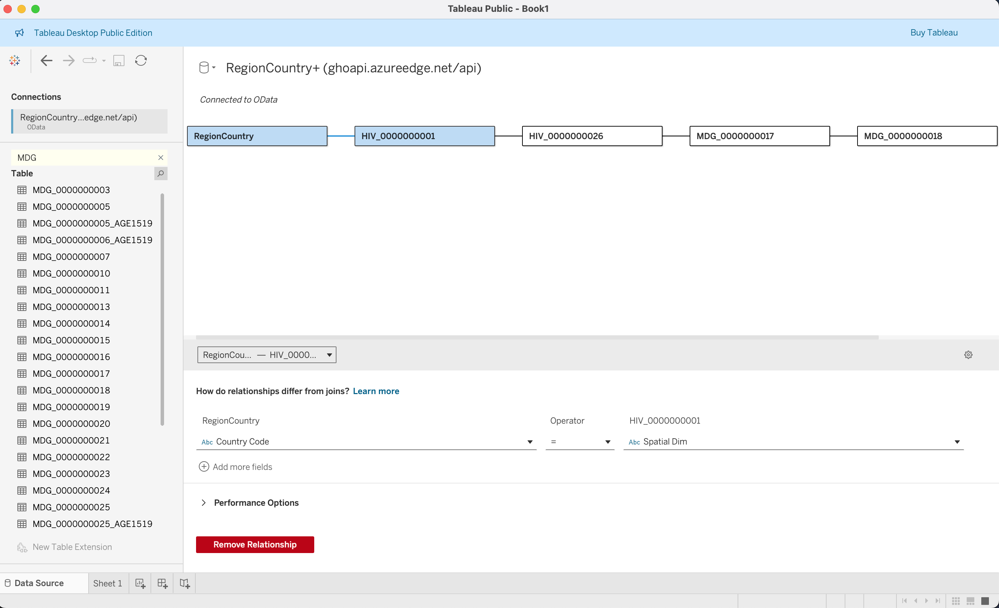
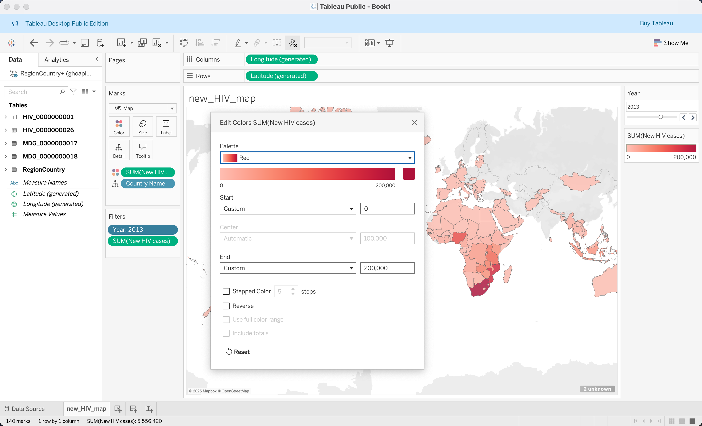
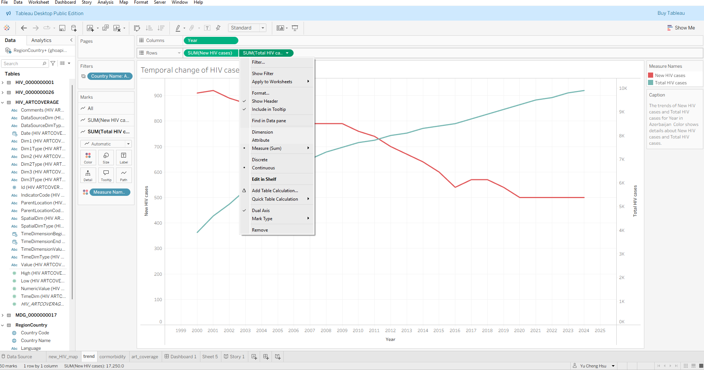
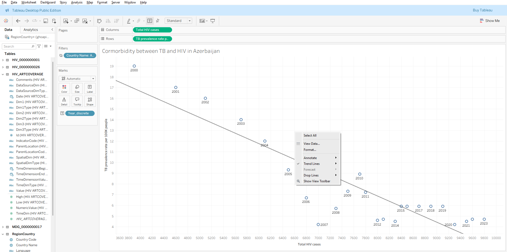
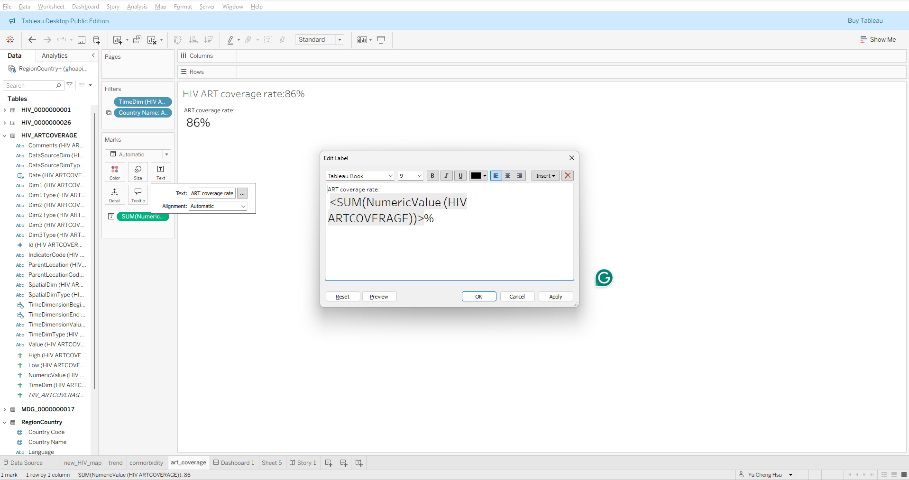
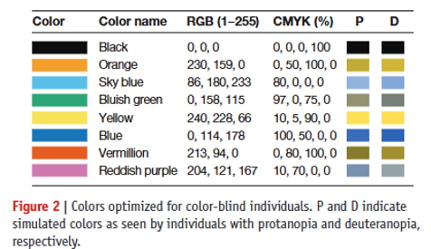
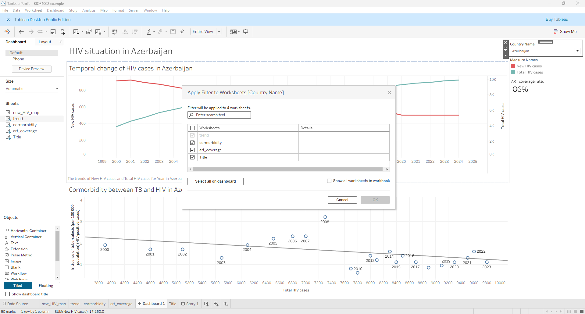
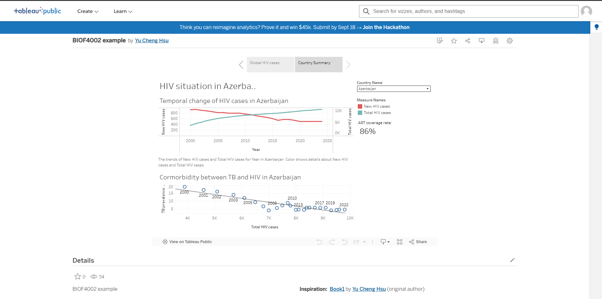

# Learning Goals
- Access and retrieve global health data programmatically
- Establish relational data models in business intelligence environments
- Apply perceptual visualization principles to public health surveillance data
- Build and publish an interactive multi-tier health informatics dashboard


```{=html}
<div class='tableauPlaceholder' id='viz1757429236454' style='position: relative'><noscript><a href='#'></a></noscript><object class='tableauViz'  style='display:none;'><param name='host_url' value='https%3A%2F%2Fpublic.tableau.com%2F' /> <param name='embed_code_version' value='3' /> <param name='path' value='shared&#47;Q9832J6T9' /> <param name='toolbar' value='yes' /><param name='static_image' value='https:&#47;&#47;public.tableau.com&#47;static&#47;images&#47;Q9&#47;Q9832J6T9&#47;1.png' /> <param name='animate_transition' value='yes' /><param name='display_static_image' value='yes' /><param name='display_spinner' value='yes' /><param name='display_overlay' value='yes' /><param name='display_count' value='yes' /><param name='language' value='zh-TW' /></object></div>                <script type='text/javascript'>                    var divElement = document.getElementById('viz1757429236454');                    var vizElement = divElement.getElementsByTagName('object')[0];                    vizElement.style.width='900px';vizElement.style.height='700px';                    var scriptElement = document.createElement('script');                    scriptElement.src = 'https://public.tableau.com/javascripts/api/viz_v1.js';                    vizElement.parentNode.insertBefore(scriptElement, vizElement);                </script>
```
# Getting WHO Observatory Data Source

## WHO Observatory

The Global Health Observatory (GHO) is the World Health Organization's (WHO) dedicated platform designed to enable users to explore a vast array of health data from around the world. Its primary purpose is to provide accessible, comprehensive insights into health-related indicators and country-specific data, supporting informed decision-making in global public health.

Key features include an extensive collection of [health indicators](https://www.who.int/data/gho/data/indicators), and detailed [country profiles](https://data.who.int/countries). The platform covers many general health indicators including mortality and burden of diseases, the Millennium Development Goals (child nutrition, child health, maternal and reproductive health, immunization, HIV/AIDS, tuberculosis, malaria, neglected diseases, water and sanitation), non-communicable diseases and risk factors, epidemic-prone diseases, health systems, environmental health, violence and injuries, and equity among others.



::: {.callout-note}
# Exercise

1. Identify some indicators in GHO.
2. How do these data associate with global health?

:::


## Getting GHO Data

Two ways of getting GHO data:

1. Directly download
2. API request

# Introduction to Tableau

Tableau is one of the most popular business visualization tools for designing dashboards for business intelligence and data analytics. Some other options you might have seen before include Microsoft Power BI, Qlik Sense, or ArcGIS. The following workshop will demonstrate how to build a dashboard from scratch.


## Prerequisites

- Tableau Public installed.
- An internet connection to access the GHO API.

# Import Data

First things first, we need data to visualize. Tableau supports data retrieval from three categories:

1. Direct import
2. Import from database
3. Import from API



## Import from API
In this example, 
1. select `OData` 
2. and input `https://ghoapi.azureedge.net/api`.

Currently, we need to find the documentation of the GHO data at `https://ghoapi.azureedge.net/api/Indicator`

3. In this workshop we are going to use the following datasets 

- `RegionCountry` Country short name and the original name
- `HIV_0000000001` Estimated number of people (all ages) living with HIV
- `HIV_0000000026` Estimated number of newly infected HIV
- `HIV_ARTCOVERAGE` Antiretroviral therapy (ART) coverage among people living with HIV (%)
- `TB_e_inc_tbhiv_100k`Incidence of tuberculosis (per 100 000 population) (HIV-positive cases)


The import order matters a bit, and you will know the reason in the following.  

## Link Up Data

All the tables in GHO are designed and stored in spatial dimensions, and the actual name of the country is stored separately in `RegionCountry`, and each dataset also has the same country information and `Time Dim` indicating the year which it stands for. We need to indicate such relationships to let the program know what these are referring to the same thing.

On the way you iteratively import the data starting from 
`RegionCountry`. You need to indicate the relationship between previously imported datasets, or create a new base dataset.

So for the first one between `RegionCountry` and `HIV_0000000001`, we specify `Country Code = Spatial Dim`.

For the rest of the relationships, you need to specify two conditions:

1. `Spatial Dim = Spatial Dim`
2. `Time Dim = Time Dim`




# Concept Deep Dive: Data modeling and architecture

In the large scale data putting all information in one big table is unrealistic for the following reasons

- Loading speed 
- Access control
- Updating table
- Scalability

## Why an excel file is not enough

| Criterion | Flat Denormalized Tables (e.g., Wide Excel / CSV) | Normalized Relational / Star Schema (WHO GHO Model)   |
| --- | ----- | ----- |
| Data Integrity & Consistency     | **Low**: Country names, codes, and region tags are duplicated on every row. Vulnerable to spelling variations (e.g., "Swaziland" vs. "Eswatini"), update anomalies, and orphan records. | **High**: Country attributes reside in a single row inside RegionCountry. Updating an official country name or regional boundary requires modifying only one record without touching millions of historical indicator rows.                     |
| Storage Efficiency               | **Poor**: Storing long text strings (e.g., "United Kingdom of Great Britain and Northern Ireland") repeated across hundreds of indicators and decades creates massive data bloat.                                      | **Optimal**: Indicator tables store compact keys (e.g., 3-character ISO strings or integer IDs) alongside numeric values, minimizing disk footprint and memory bandwidth.                                                                       |
| Query & Aggregation Optimization | **Rigid / Slow at Scale**: Adding a new health indicator requires modifying the entire table schema (adding columns) or stacking incompatible formats. Broad aggregation queries scan large amounts of redundant text. | **Fast & Modular**: Fact tables are append-only. New indicators exist as independent tables that link dynamically via existing dimension keys (Spatial Dim, Time Dim). Analytical engines only scan the specific columns requested by the user. |
| Sparse Matrix Handling           | **Inefficient**: Indicators measured irregularly (e.g., every 3–5 years) force flat tables to store vast expanses of NULL or empty cells across millions of combinations.                                              | **Compact**: If a country did not collect a specific metric in a given year, no row is inserted into that indicator’s fact table, preventing unnecessary overhead.                                                                              |

::: {.callout-tip}
# Exercise questions

Scenario: In 2018, the Kingdom of Swaziland officially changed its name to the Kingdom of Eswatini. What will be the impact for using Excel to store the data compare with the GHO model

:::

::: {.callout-note collapse="true"}
## Suggested Answers

In a flat spreadsheet: An analyst must run a batch search-and-replace across millions of historical rows spanning dozens of indicators. If an error occurs, historical records for "Swaziland" and modern records for "Eswatini" will fragment into two separate entities, breaking longitudinal trend lines.

In the WHO GHO schema: The fact records remain unchanged because the spatial key (e.g., ISO code SWZ) remains constant. Only one entry in the RegionCountry dimension table is updated: Country Name = "Eswatini". Every connected visualization in Tableau immediately updates without altering the underlying observational facts.
:::

## Modern data warehouse 

In most of the data warehouses and business intelligence systems context, we will divide table into

- Fact tables (quantitative health observations)
  - Contents: Numerical measurements + **foreign keys** that link to dimension tables
  - Structure: Narrow and very tall
- Dimension tables (the context surrounding those observations).
  - Contents: Textual attributes, labels, categories, and a **primary key** (often a surrogate integer ID)
  - Structure: Short and wide (many descriptive columns, fewer total rows)

- *Primary key*: the official ID card for a row in a table.
- *Foreign keys*: Stores the exact primary key value from another table

| Feature         | Primary Key (PK)                                      | Foreign Key (FK)                             |
| -- | ---- | ---- |
| Primary Purpose | Uniquely identifies a row in its own table            | Links to a primary key in another table      |
| Null Values     | Not allowed (Must have a value)                       | Allowed (Can be blank or null)               |
| Duplicates      | Not allowed (Every value is unique)                   | Allowed (Repeats across many rows)           |
| Where it lives  | Dimension tables (e.g., `Spatial Dim` in `RegionCountry`) | Fact tables (e.g., `Spatial Dim` in `HIV_0000000001`) |

::: {.callout-tip}
# Exercise questions

In our example which table is a Fact table? which is a dimension table?

```text
[ RegionCountry (Dimension) ]
                     │
            (Spatial Dim / Code)
                     ▼
  [ HIV_0000000001 / TB Fact Table ]
        - Spatial Dim (FK)
        - Time Dim (FK)
        - Numeric Value (Measure)
```

:::

::: {.callout-note collapse="true"}
## Suggested Answers

RegionCountry is a dimension table. HIV_0000000001 and others are fact tables 
:::

## Application Programming Interface (API) design

| Dimension | File download | API |
| --- | ----- | ----- |
| **Pipeline Maintenance** | Manual download, unzipping, local path mapping, and recurring re-import. | Fully automated; BI connectors query the schema directly via a persistent URL. |
| **Bandwidth & Latency** | Downloads entire datasets (often >90% irrelevant indicators/years). | Transmits strictly what is requested via `$filter`, `$select`, and `$top`. |
| **Data Synchronization** | Prone to version fragmentation (e.g., `GHO_HIV_2024_v2_final.csv`). | Single Source of Truth; automatically captures upstream revisions and backfills. |
| **Scale & Stability** | Memory crashes when reading monolithic files on low-spec hardware. | Protected by server-side pagination and progressive cursor streaming. |


::: {.callout-tip}
# Exercise questions

Suppose you published this dashboard to Tableau Public today. Tomorrow morning, the WHO updates its database: they backfill missing TB comorbidity data for 10 countries and add 2025 data.

1. If you used a downloaded CSV file, what steps must you take to reflect this?
2. If you used the API, what happens when you refresh? 
3. What is one potential risk or breaking change if the WHO alters an indicator's column name or schema definition upstream?"
:::

::: {.callout-note collapse="true"}

## Suggested Answers

1. **Manual Re-downloading & File Replacement**, **Data Re-cleaning & Schema Checks**, **Re-linking in Tableau**.  
2. **Automated Data Fetching**, **Seamless Dynamic Ingestion**,**Instant Visual Updates**
3. **Missing Column Error**, **Dashboard Disruption**

:::

# Visualizing the Data

After aggregating all the data, we can design our dashboard. The process of building up the tool is:

1. Select visualization tool
2. Select data needed to display in the visualization tool
3. Configure the tool

## Concept Deep Dive: Mackinlay’s Ranking of Visual Encodings

In 1986, computer scientist Jock Mackinlay extended Jacques Bertin’s semiology of graphics to develop an automated design theory for graphical presentations. His framework evaluates visual presentations using two foundational criteria:

1. **Expressiveness**: A visual encoding is expressive if and only if it communicates all of the intended information, and none of the false or unintended information.

2. **Effectiveness**: A visual encoding is effective if it exploits the capabilities of the human visual system to decode the data with **maximum accuracy, minimal cognitive effort**, and lowest error rate.

| Ranking | Quantitative (Q) | Ordinal (O) | Nominal (N) |
| -- | ---- | ---- | ---- |
| 1 |   Position on common scale  |  Position on common scale  |   Position on common scale  |
| 2 | Position on unaligned scale | Position on unaligned scale| Position on unaligned scale |
| 3 |             Length          |             Length         |   Hue / Color (Categorical) |
| 4 |        Angle / Slope        |         Angle / Slope      |           Texture           |
| 5 |              Area           |       Color Saturation     |           Connection        |
| 6 |       Depth (3D Position)   | Color Luminance (Lightness)|          Containment        |
| 7 |    Color Luminance / Value  |             Shape          |              Shape          |
| 8 |       Color Saturation      |             Area           |             Length          |
| 9 |          Curvature          |            Depth           |              Angle          |
| 10 |             Shape          |            Curvature       |              Area           |

Table: Mackinlay’s Ranking of Perceptual Effectiveness (Top = Most Accurate  │  Bottom = Least Accurate)

## Landing Page: Newly Infected HIV Cases Worldwide

For the first visualization, we would like to inform the user about the newly infected HIV cases in the world.

::: {.callout-note}
# Exercise

Name the data source and column you need.

:::

1. Create new Sheet, and we name it as `new_HIV_map`
2. Drag `Country Name` from `RegionCountry` to the center of the panel and select the `Filled Map` in the `Show Me` tab
3. Rename `Numeric Value` in `HIV_0000000026` to `New HIV cases`
4. Rename `Time Dim` in `HIV_0000000026` to `Year` (Choose one with icon `#`, indicating this is treated as a continuous value)
5. Drag `Year` to Filters, change it to display as discrete values, and click Show Filter
6. Drag `New HIV cases` to Color and set the summarize function as `SUM`
7. Set the filter on `New HIV cases` by clicking the triangle at the Marks card and make it only include non-null values
8. Set the `Year` filter to a slider at the right hand side panel by right-clicking it and selecting Slider.
9. Set the color gradient and customize the values at the right hand side panel by selecting Edit Colors, and rename the title  as `New HIV cases per year`
10. Set the title as `Global New HIV Infection in <Year>`




## Country Summary Panel

### Create the line plot Chart (Total HIV population vs. New HIV by Year)

1. Rename `Numeric Value` in `HIV_0000000001` to `Total HIV cases`
2. Drag  `Year` in `HIV_0000000026` to x-axis.
3. Drag  `Total HIV cases` in `HIV_0000000001` and `New HIV cases` in `HIV_0000000026` to the Rows shelf (Y-axis), aggregating both with  `SUM`.
4. Choose either `Total HIV cases` or `New HIV cases` and select `dual axis`
5. Similar to adding the Year filter, this time we add a `Country Name` filter and make it into a dropdown box
6. Rename the title as `Temporal Change of HIV Cases in <Country Name>`
7. Add trend lines by right-clicking in the middle



## Comorbidity between HIV and TB

1. Drag `Total HIV cases` from `HIV_0000000001` to the x-axis, select it as dimension.

2. Rename `Numeric Value` in `TB_e_inc_tbhiv_100k` to `Incidence of tuberculosis (per 100 000 population) (HIV-positive cases)`, drag it to the y-axis, and select it as dimension.

3. Drag `Year` to the `Label` marks
4. Add the trend line by right-clicking in the middle of the sheet and selecting "Show Trend Lines"




## Text indicating ART coverage rate 

1. Drag `Numeric Value` from `HIV_ARTCOVERAGE` to the middle of the sheet
2. Add a `Year` filter and set it to 2024 without displaying the filter in the sheet
3. Add a  `Country Name` filter
4. Edit the display text to `ART coverage rate: <SUM(NumericValue (HIV ARTCOVERAGE))> %` by clicking the `Text` button and then pressing `...`



## Application of Mackinlay's Principle

| Dashboard View | Primary Channels Used | Mackinlay Ranking & Perceptual Assessment | Design Implication |
| --- | ---- | ------ | ------ |
| **Comorbidity Scatter Plot** (TB vs. HIV) | **Position on Common Scale** ($X$ and $Y$ coordinates) | Rank 1 for Quantitative: The human visual system evaluates Cartesian positions with the highest mathematical accuracy. | Ideal for detecting correlations, clusters, and regression slopes without distortion. |
| **Temporal Dual-Axis Trend** (HIV Cases over Time) | **Position / Slope**, differentiated by **Color Hue** | Rank 1 (Position) for values; Rank 3 (Hue) for categories: The position along the shared temporal $X$-axis decodes rate of change accurately. Hue separates the two metrics without cognitive interference. | Ensures rapid interpretation of trends, though dual axes must maintain synchronized or clearly separated zero baselines to avoid misleading slope comparisons. |
| **Global Choropleth Map** (New HIV Cases) | **Color Saturation / Luminance** overlaid on **Geographic Area** | Rank 7/8 (Color) and Rank 5/10 (Area): Lower perceptual accuracy than position. Area acts as a confounding variable because large landmasses visually dominate irrespective of disease burden. | Effective for macro spatial patterns and geographic orientation, but poor for precision comparisons between countries. |

## Rules of thumb

1. Use Position for Your Primary Question
2. Reserve Color Hue for Nominal Categories, Saturation for Intensity:
3. Inclusive design and be aware of cultural context
   1. Color-blindness friendly
   2. Cultural context
      1. Red-green color in stock market
      2. Blue-red and sex implications



# Assemble Country Dashboard

## Assemble dashboard
1. Create a new dashboard (The icon with a + sign in a square)
2. Drag the above two country specific sheets to the dashboard
3. From the temporal trend of new HIV and total HIV sheet, select `Filters` -> `Country Name`
4. Change the filter to a drop-down menu and select `Apply to Worksheets` -> `Selected Worksheets` and apply to the comorbidity and text worksheets.



## Assemble to story 

1. Create a new `Story`
2. Drag the map sheet to the page and label the tab as `Global HIV cases`
3. Create a new page and drag the dashboard to the page and label the tab as `Country summary`

# Publishing dashboard

If you signed in with your Tableau account, then you can save in Tableau Public, which will automatically share your dashboard to the public.

By default, it will use the sheet/dashboard/story you are viewing while saving the file as the page that first displays to the public. If you want to change it, you can go to the designated pages and save again.



# Principles of Designing a Dashboard or Data Story

1. Identifying target audience
2. Preparing data
   1. Retrieving data
   2. Building up data relationship
3. Build the dashboard
   1. Identifying adequate display
   2. Building up each visualization
   3. Assembling together
4. Testing

## Additional things 

Formatting appearance
: For any display item on the dashboard, you can right click on the item and select `Format` to adjust and design the format of display
  
Writing captions
: For all sheets, dashboards, and stories, you can write a caption to describe your display.

# Health Data Governance, Ethics & Policy

When analyzing surveillance feeds from platforms like the WHO Global Health Observatory (GHO), encountering `NULL` values or missing reporting years is common. In technical dashboard pipelines, the default instinct is often simply to filter them out (e.g., configuring filter cards to "only include non-null values"). In public health epidemiology, however, omitting missing data without understanding the underlying mechanism introduces profound systematic bias.

## Missing Completely at Random (MCAR) 

   - **Definition**: The probability of an observation being missing is entirely independent of both observed variables and unobserved patient/national status.
   - **Example**: A rural clinic's physical logbooks or electronic records are destroyed by an unforeseen localized flood. The missing reports bear no mathematical relationship to actual local HIV or TB infection rates.
   - **Analytical Impact**: While statistical power is reduced, simply dropping these records generally does not systematically bias point estimates.

## Missing at Random (MAR)

- **Definition**: Missingness depends systematically on observed covariates (e.g., national wealth, healthcare infrastructure tier) but not on the missing value itself once those covariates are controlled for.
- **Example**: Lower-Middle-Income Countries (LMICs) with lower gross domestic product per capita frequently report HIV incidence or ART coverage every three to five years rather than annually, primarily due to the logistics and recurring costs of national biomarker surveys.
- **Analytical Impact**: Dropping these records induces reporting bias unless adjusted via statistical weighting, imputation models, or stratifying by development index.

## Missing Not at Random (MNAR) — The Informative Null

- **Definition**: Missingness directly relates to the unobserved value itself, or to latent variables such as political censorship and social stigma.
- **Example**: A jurisdiction omits or halts reporting on new HIV transmissions or key high-risk demographics specifically during an uncontrolled surge in infections to avoid international economic sanctions or political embarrassment. Alternatively, criminalization and societal stigma prevent marginalized populations from accessing diagnostic testing entirely.
- **Analytical Impact**: Filtering out `NULL` values here creates an artificial illusion of public health success. The missing data points are systematically worse than the reported data points.

## Surveillance Pitfalls & Misinterpretations 

**Clinical Enrollment Truncation**: In regions with constrained diagnostic capacity or decentralized primary care, individuals with severe, rapid disease progression (such as untreated opportunistic infections or fulminant drug-resistant TB) often die before reaching a testing facility. Consequently, national clinical cohorts (`HIV_ARTCOVERAGE`) inadvertently sample patients with slower-progressing disease or better baseline access to health services.

**The "Rising Prevalence Paradox"**:When ART coverage expands significantly within a country, the total number of people living with HIV (`HIV_0000000001`) often increases rather than decreases over time.   An untrained dashboard user might view a rising curve as an operational failure. In reality, broader ART coverage prevents premature mortality, transforming a fatal infection into a chronic manageable condition. Patients survive longer within the cohort, causing prevalence to accumulate even as newly acquired incident cases (`HIV_0000000026`) decline. 

**The Ecological Fallacy in Macro Visualizations** The Ecological Fallacy occurs when an analyst infers individual-level clinical causality from aggregated national data.

For instance, plotting national HIV prevalence against national TB incidence and observing a positive regression slope does not prove that every HIV patient is contracting TB[cite: 8]. The two epidemics could be clustered in entirely different sub-populations within the same nation (e.g., HIV in urban transport hubs vs. TB in rural mines). Biological comorbidity must be validated via patient-level clinical studies, not assumed solely from macro correlations on a dashboard.